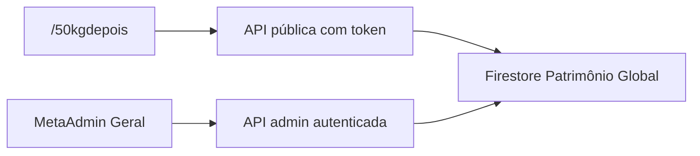

# Arquitetura da entrevista — 50 KG DEPOIS

## Visão geral

## Fluxo do participante

1. **Abertura** — mensagem editorial, tom de entrevista (não formulário clínico)
2. **Consentimento** — uso como material de pesquisa/editorial nesta etapa
3. **20 capítulos** — perguntas em textarea expansível, progresso por capítulo
4. **Memórias livres** — histórias não cobertas pelas perguntas
5. **Conclusão** — confirmação e opção de revisar

## Estados da UI

| Estado | Descrição |
|--------|-----------|
| `intro` | Tela de abertura |
| `consent` | Checkbox de consentimento |
| `interview` | Capítulos 1–20 |
| `memories` | Memórias adicionais |
| `complete` | Tela final |
| `review` | Navegação para editar respostas anteriores |

## Autosave

- Debounce de ~900 ms após digitação
- Salvamento ao avançar/voltar de capítulo
- Indicadores discretos: `Salvando...` → `Salvo`
- Retomada via Firestore + token persistido em `localStorage`

## APIs públicas (login Firebase obrigatório)

Todas as rotas exigem header `Authorization: Bearer <firebase_id_token>`.

| Método | Rota | Função |
|--------|------|--------|
| GET | `/api/50kgdepois/validate` | Confirma sessão autenticada |
| GET | `/api/50kgdepois/load` | Carrega sessão completa |
| POST | `/api/50kgdepois/save` | Salva respostas, consentimento ou memórias |

## APIs admin / redação (mesmo login)

| Método | Rota | Função |
|--------|------|--------|
| GET | `/api/metaadmingeral/50kg-depois/participants` | Lista participantes |
| GET | `/api/metaadmingeral/50kg-depois/participants/[id]` | Detalhe com respostas |

## Camada editorial futura (não implementada)

O campo `editorialMeta` no participante está reservado para:

- análise por IA
- extração de cenas e timeline
- personagens, rupturas, mapa emocional
- anexos (fotos, exames, áudios)
- organização por capítulo do livro final

Nenhuma dessas funcionalidades está ativa nesta entrega.

## Referência visual

A experiência reutiliza padrões de `/whitelabel`:

- layout mobile-first (`max-w-lg` / `md:max-w-2xl`)
- barra de progresso sticky
- botões e inputs de `CadastroMedicoFormUi`
- animações com `framer-motion`

A página `/whitelabel` não foi alterada.
