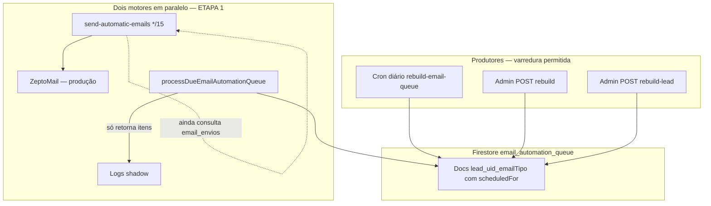

# Fila de automação de e-mails (`email_automation_queue`)

**Etapa:** 1 — Infraestrutura (shadow mode)  
**Status:** Fila materializada; motor legado (`send-automatic-emails`) continua enviando.

---

## Motivação

O cron legado descobre leads elegíveis **a cada execução** (15 min), listando Firebase Auth, solicitações, pacientes e consultando `email_envios` por lead. Isso gera leituras repetidas no Firestore.

No módulo WhatsApp resolvemos o mesmo problema com **`whatsapp_automation_queue`**: produtores materializam envios futuros; o cron consumidor lê só itens `pending` vencidos.

Esta etapa replica o **mesmo padrão arquitetural** para a campanha leads médico (email1–email5), **sem alterar** regras de envio, templates, horários nem o cron atual.

---

## Arquitetura



---

## Coleção `email_automation_queue`

Um documento = **um envio futuro** da sequência leads médico.

| Campo | Descrição |
|-------|-----------|
| `id` | `lead_{leadId}_{emailTipo}` (determinístico) |
| `organizationId` | Organização (default: `metodo`) |
| `doctorId` | Reservado; vazio na campanha leads |
| `leadId`, `leadNome`, `leadEmail` | Identificação do lead |
| `emailTipo` | `email1` … `email5` |
| `scheduledFor` | Instante do envio (createdAt + offset) |
| `status` | `pending` \| `processing` \| `sent` \| `failed` \| `skipped` |
| `payloadVersion` | `1` |
| `createdAt`, `updatedAt`, `sentAt`, `errorMessage` | Metadados |

### Horários (`scheduledFor`)

Espelham o cron legado (`lib/email/leadsMedicoEmailSchedule.ts`):

| E-mail | Offset após cadastro |
|--------|----------------------|
| email1 | +1 hora |
| email2 | +24 horas |
| email3 | +72 horas |
| email4 | +7 dias |
| email5 | +14 dias |

---

## IDs determinísticos

Função: `buildEmailAutomationQueueId(leadId, emailTipo)` → `lead_{leadId}_{emailTipo}`

Regras (iguais ao WhatsApp):

- Rebuild repetido **não duplica** documentos.
- Itens `pending` têm campos mutáveis atualizados (nome, e-mail, horário).
- Itens já `sent` / `failed` / `skipped` / `processing` **nunca voltam** para `pending`.

---

## Estados

| Status | Significado |
|--------|-------------|
| `pending` | Aguardando consumidor (ETAPA 2) |
| `processing` | Reservado para lock futuro |
| `sent` | Enviado (sync com `email_envios` no rebuild ou consumidor futuro) |
| `failed` | Falha de envio (ETAPA 2) |
| `skipped` | Lead convertido ou inelegível |

---

## Produtores (quem alimenta a fila)

| Produtor | Arquivo | Gatilho |
|----------|---------|---------|
| Cron diário | `app/api/cron/rebuild-email-queue/route.ts` | Vercel `45 6 * * *` |
| Rebuild admin | `app/api/metaadmingeral/automacoes/email-queue/rebuild/route.ts` | POST manual |
| Rebuild lead | `app/api/metaadmingeral/automacoes/email-queue/rebuild-lead/route.ts` | POST `{ leadId }` |
| Rebuild médico | mesmo endpoint rebuild `{ doctorId }` | Skip pending de leads convertidos ao médico |

Lógica de rebuild: `services/emailAutomationRebuildService.ts`

- Percorre leads Auth elegíveis (mesmos filtros do cron legado).
- Lê `email_envios` em batch (somente leitura) para marcar itens já enviados como `sent`.
- Leads convertidos (solicitação médico / paciente com médico) → itens `skipped`.
- **Não envia e-mails.**

---

## Consumidor (ETAPA 1 — preparado)

`processDueEmailAutomationQueue()` em `services/emailAutomationConsumerService.ts`

Query:

```
status == 'pending' AND scheduledFor <= now ORDER BY scheduledFor LIMIT N
```

**Ainda não envia.** Apenas retorna itens e registra log `[email-automation-queue][consumer][shadow]`.

---

## Serviços

| Arquivo | Responsabilidade |
|---------|------------------|
| `types/emailAutomationQueue.ts` | Tipos, ID determinístico |
| `lib/email/leadsMedicoEmailSchedule.ts` | Offsets da sequência |
| `services/emailAutomationQueueService.ts` | CRUD fila, stats, getPendingItems |
| `services/emailAutomationRebuildService.ts` | Rebuild org / lead / doctor |
| `services/emailAutomationConsumerService.ts` | Consumidor shadow (sem envio) |

### API da fila (`emailAutomationQueueService.ts`)

- `enqueueLeadEmail()` / `enqueueLeadSequence()`
- `upsertQueueItem()`
- `markQueueItemSent()` / `Failed()` / `Skipped()` / `Processing()`
- `getPendingItems()`
- `removeQueueItem()`
- `stats()` — `count()` por status

---

## Rotas

| Método | Rota | Função |
|--------|------|--------|
| GET | `/api/cron/rebuild-email-queue` | Rebuild diário (shadow) |
| POST | `/api/metaadmingeral/automacoes/email-queue/rebuild` | Rebuild all / org / doctor / lead |
| POST | `/api/metaadmingeral/automacoes/email-queue/rebuild-lead` | Rebuild um lead |
| GET | `/api/metaadmingeral/automacoes/email-queue/stats` | Estatísticas count() |
| GET | `/api/metaadmingeral/automacoes/email-queue/shadow-stats` | Shadow validation (ETAPA 1.5) |
| POST | `/api/metaadmingeral/automacoes/email-queue/set-engine` | Governança `automation.email.engine` |

Ver também: [email_cutover.md](./email_cutover.md)

**Não alterados:** `/api/cron/send-automatic-emails`, templates, `email_envios`.

---

## Índices Firestore

Composto em `email_automation_queue`:

- `status` ASC
- `scheduledFor` ASC

Usado por `getPendingItems()` e `stats().dueNow`.

Índice simples automático em `leadId` para `listQueueItemsByLead()`.

---

## Shadow mode (ETAPA 1)

| Motor | Comportamento |
|-------|----------------|
| **Legado** | Continua enviando via Zepto; consulta Auth + email_envios |
| **Novo** | Apenas materializa e mantém fila; consumidor só lê |

Permite comparar stats da fila (`dueNow`, `counts`) com o motor legado antes da ETAPA 2.

---

## Diferenças em relação ao motor antigo

| Aspecto | Motor antigo | Fila nova |
|---------|--------------|-----------|
| Descoberta de elegíveis | A cada 15 min | No rebuild / gatilho |
| Leitura email_envios | Por lead candidato | Só no rebuild (batch) |
| Cron de envio | Envia + decide | ETAPA 2: só fila vencida |
| Dedup | email_envios | ID determinístico + email_envios no rebuild |

---

## ETAPA 1.5 — Shadow validation

**Flag:** `EMAIL_QUEUE_SHADOW_VALIDATION=true`

Quando ativa, o cron legado (`send-automatic-emails`) compara cada lead apto com o motor de fila **antes do envio real**:

| Motor | Papel |
|-------|-------|
| Legado | Continua enviando (produção) |
| Fila | Só responde `would_send` / `would_not_send` (read-only) |

### Logs

Prefixo: `[email_queue_shadow]`

Campos: `timestamp`, `leadId`, `organizationId`, `doctorId`, `emailTipo`, `legacyDecision`, `queueDecision`, `legacyReason`, `queueReason`, `status` (`MATCH` \| `MISMATCH`), `mismatchKind`.

### Métricas (Firestore)

- `email_queue_shadow/aggregate` — totais e `byEmailTipo`
- `email_queue_shadow_mismatches` — últimos mismatches

### Endpoint

`GET /api/metaadmingeral/automacoes/email-queue/shadow-stats`

### Critério de cutover (ETAPA 2)

- `matchRate >= 99.9%`
- `totalComparisons >= 100`
- Zero mismatches **críticos** (`legacy would_send` + fila ausente/atrasada)

### Arquivos

- `lib/email/emailQueueShadowValidation.ts`
- `services/emailQueueShadowValidationService.ts`
- Hook em `app/api/cron/send-automatic-emails/route.ts` (try/catch — nunca bloqueia envio)

---

## ETAPA 2 (futuro — após shadow validado)

1. Cron consumidor passa a enviar e marcar `sent`.
2. Gradualmente reduzir consultas do cron legado.
3. Evento no signup → `rebuild-lead`.
4. Cutover por feature flag quando shadow-stats aprovar.

---

## Referência WhatsApp

| WhatsApp | E-mail |
|----------|--------|
| `whatsapp_automation_queue` | `email_automation_queue` |
| `whatsappAutomationQueueService.ts` | `emailAutomationQueueService.ts` |
| `whatsappRemindersService.ts` (rebuild) | `emailAutomationRebuildService.ts` |
| `processDueWhatsappAutomationQueue` | `processDueEmailAutomationQueue` |
| `rebuild-whatsapp-queue` | `rebuild-email-queue` |
