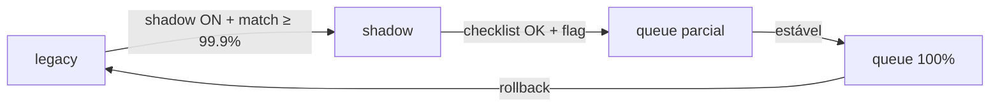

# Cutover — motor de e-mails automáticos

**Etapa atual:** preparação de governança (pré-ETAPA 2)  
**Produção:** motor **legacy** continua enviando todos os e-mails.

---

## Objetivo

Migrar gradualmente de:

| Motor | Descrição |
|-------|-----------|
| **legacy** | Cron descobre elegíveis a cada 15 min + consulta `email_envios` |
| **shadow** | Legacy envia; fila comparada em paralelo (validação) |
| **queue** | Fila materializada consome e envia (futuro) |

---

## Governança por organização

**Coleção Firestore:** `automation_email_engine`  
**Campo:** `automation.email.engine` (e espelho `engine`)

| Valor | Significado |
|-------|-------------|
| `legacy` | **Default.** Só motor legado envia |
| `shadow` | Legacy envia + shadow validation ativa (governança explícita) |
| `queue` | Reservado ETAPA 2+ — fila envia |

**Resolução:** `getEmailAutomationEngine(organizationId)` em `lib/email/getEmailAutomationEngine.ts`

- Sem documento → `legacy`
- **Cron ainda não consulta** este valor (ETAPA pré-cutover)

### Alterar motor (admin)

```http
POST /api/metaadmingeral/automacoes/email-queue/set-engine
{ "organizationId": "metodo", "engine": "shadow" }
```

```http
GET /api/metaadmingeral/automacoes/email-queue/set-engine?organizationId=metodo
```

---

## Estratégia de migração



### Fase 0 — Hoje (aprovado)

- Fila materializada (`email_automation_queue`)
- Rebuild diário (`rebuild-email-queue`)
- Shadow validation (`EMAIL_QUEUE_SHADOW_VALIDATION=true`)
- Engine por org persistido, default `legacy`

### Fase 1 — Shadow validation (em curso)

- Comparar decisões legado × fila
- Logs `[email_queue_shadow]`
- Métricas em `shadow-stats`

### Fase 2 — Cutover gradual (ETAPA 2 — piloto)

1. Checklist shadow: ≥500 comparações, match ≥99.9%, zero crítico 72h
2. `POST set-engine` → `{ "organizationId": "metodo", "engine": "queue" }`
3. Cron consulta `getEmailAutomationEngine()` **antes** de qualquer decisão
4. Motor `queue`: consome só `email_automation_queue` (pending + scheduledFor ≤ now)
5. Motor `legacy`/`shadow`: fluxo legado intacto
6. Rollback: `set-engine` → `legacy` (sem deploy)
7. Monitorar dashboard `email-queue/stats` (throughput, latência, comparação legacy vs queue)
8. Expandir: Mentorado 01 → 02 → 5 orgs → 20 → 100%

**Serviço:** `processEmailQueueAutomationEngine()` em `services/emailAutomationEngineProcessor.ts`

**Observabilidade:** `automationExecutionId` em logs, fila, `email_envios`, header Zepto `X-Automation-Execution-Id`

**Circuit breaker:** por organização (`automation_engine_circuit`) — falhas SMTP consecutivas, latência extrema, erro Firestore

### Fase 3 — Descomissionar legacy

- Remover varredura Auth + email_envios no cron legado
- Manter `email_envios` como ledger histórico

---

## Critérios para promoção (ETAPA 2)

Checklist **obrigatório** (retornado em `shadow-stats` → `operationalChecklist`):

| # | Critério | Campo |
|---|----------|-------|
| 1 | Match rate ≥ **99,9%** | `matchRateAtLeast999` |
| 2 | ≥ **500** comparações acumuladas | `comparisonsAtLeast500` |
| 3 | Zero mismatch **crítico** nas últimas **72h** | `zeroCriticalMismatchLast72h` |
| 4 | Shadow validation **ligada** | `shadowValidationEnabled` |
| 5 | Fila **populada** (rebuild OK) | `rebuildQueuePopulated` |
| 6 | Engine ainda **legacy** (controle) | `engineIsLegacy` |
| 7 | Estatísticas **consistentes** | `statisticsConsistent` |

**Mismatch crítico:** legado `would_send` + fila ausente/atrasada (`queue_stale_or_missing`).

Quando `readyForCutover: true` em `shadow-stats` por **≥ 3 dias consecutivos**, autorizar piloto ETAPA 2.

---

## Critérios para rollback

Reverter imediatamente para `legacy` se:

1. **Mismatch crítico** em produção após cutover
2. Match rate **< 99%** em janela 24h
3. Fila `dueNow` crescendo sem envio (fila travada)
4. Reclamações de e-mail duplicado ou não enviado

### Procedimento de rollback

```http
POST /api/metaadmingeral/automacoes/email-queue/set-engine
{ "organizationId": "metodo", "engine": "legacy" }
```

1. Set engine → `legacy` (< 1 min)
2. Confirmar cron legado enviando (logs Zepto)
3. Opcional: rebuild fila para resync
4. Post-mortem com logs `[email_queue_shadow]`

**Rollback não apaga** `email_automation_queue` nem `email_envios`.

---

## Monitoramento

### Endpoint principal

`GET /api/metaadmingeral/automacoes/email-queue/shadow-stats?organizationId=metodo`

Métricas extras:

| Métrica | Descrição |
|---------|-----------|
| `windows.last24h` | Comparações / match rate 24h |
| `windows.last72h` | Comparações / match rate 72h |
| `matchRateTrend24h` | Δ vs 24h anterior |
| `lastMismatchAt` | ISO timestamp |
| `lastCriticalMismatchAt` | ISO timestamp |
| `consecutiveDaysWithoutCriticalMismatch` | Dias desde último crítico |
| `criticalMismatchesInLast72h` | Contagem crítica 72h |

### Logs Vercel

```
[email_queue_shadow]
```

---

## Feature flags

| Variável | Função |
|----------|--------|
| `EMAIL_QUEUE_SHADOW_VALIDATION=true` | Ativa comparação shadow |
| `automation.email.engine` (Firestore) | Motor por org (futuro cron) |

---

## Arquivos de governança

| Arquivo | Papel |
|---------|-------|
| `types/emailAutomationEngine.ts` | Tipos `legacy` / `shadow` / `queue` |
| `services/emailAutomationEngineService.ts` | Persistência Firestore |
| `lib/email/getEmailAutomationEngine.ts` | API única de resolução |
| `app/api/.../set-engine/route.ts` | Admin set/get engine |
| `app/api/.../shadow-stats/route.ts` | Métricas + checklist |

---

## Checklist operacional de produção (antes ETAPA 2)

Execute manualmente após deploy:

- [ ] `firestore.indexes.json` deployado (fila + shadow)
- [ ] `EMAIL_QUEUE_SHADOW_VALIDATION=true` no Vercel Production
- [ ] `POST .../email-queue/rebuild` executado com sucesso
- [ ] `GET .../email-queue/stats` — fila com docs > 0
- [ ] Aguardar **≥ 500** comparações shadow (dias de cron)
- [ ] `GET .../shadow-stats` → `readyForCutover: true`
- [ ] `matchRateTrend24h` estável ou positivo
- [ ] `consecutiveDaysWithoutCriticalMismatch` ≥ 3
- [ ] Documentar engine atual (`legacy`) por org
- [ ] Plano de rollback comunicado

**Somente então:** iniciar ETAPA 2 (cron consulta engine + piloto `queue`).

---

## Referências

- [email_automation_queue.md](./email_automation_queue.md) — fila e shadow validation
- [email_envios audit](../auditoria-firestore-custos/) — custos legado
