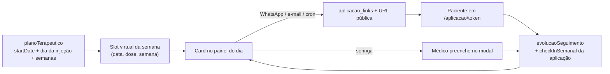

# Auditoria — Cards de aplicação no Calendário MetaAdmin (modelo de controle de envio)

**Escopo:** como os cards de aplicação funcionam na página **Calendário** do `/metaadmin`, e como esse modelo controla o envio do link para o paciente preencher.  
**Objetivo de produto:** repetir o **mesmo modelo de controle de envio** no `/metanutri` para o paciente preencher o **check-in semanal Nutri**.  
**Data:** 2026-08-17  
**Nenhuma alteração de código nesta auditoria.**

Irmão: `docs/meta/AUDITORIA_CHECKIN_DIARIO_NUTRI.md` (check-in Nutri no `/meta`).  
Não confundir o check-in **Nutri** com o check-in **já embutido** no formulário de aplicação (peso, fome da semana, etc.). São coletas diferentes; o que se copia aqui é o **controle operacional do card**, não as perguntas.

---

## 0. O que o card realmente controla

O card **não é um documento Firestore próprio**. É um **slot virtual** derivado do plano terapêutico do paciente. O médico usa o card para:

1. Ver se aquela semana **já foi registrada** (verde), **ainda vai acontecer** (laranja) ou **já passou e o paciente não preencheu** (vermelho).
2. **Mandar o paciente preencher** — ícone WhatsApp gera um link público `/aplicacao/{token}` e abre o `wa.me` com a mensagem pronta.
3. **Preencher no lugar do paciente** — ícone seringa abre o mesmo questionário no consultório.
4. Ver evolução (Δ peso, Δ circunferência, anel de score, fotos, gráfico).

Quando o paciente (ou o médico) grava, o card **muda de cor sozinho** no próximo refresh: o calendário só relê `evolucaoSeguimento`. Não há “marcar como enviado” no card além dos badges do WhatsApp automático.



---

## 1. Onde vive a UI

| Superfície | Arquivo | Papel |
|------------|---------|--------|
| Calendário principal do médico | `app/metaadmin/page.tsx` (`activeMenu === 'calendario'`) | Cards completos: status + WhatsApp + seringa + score |
| Mini calendário / modal mobile do paciente | `components/metaadmin/TratamentoPacienteMobileModal.tsx` | Mesma paleta de cores; WhatsApp de aplicação também existe no mobile do calendário (~L35754) |
| Calendário MetaNutri / MetaPersonal | `components/profissional/ProfissionalCalendarioSection.tsx` | **Visual parecido, controle de envio da aplicação ausente** |
| Lista operacional (MetaAdminGeral) | `components/CalendarioAplicacoes.tsx` | Tabela + status de e-mail; não é o card do calendário do médico |

Menu: `/metaadmin` → **Calendário**. Grid mensal à esquerda; ao clicar no dia, painel direito lista os cards **Aplicações (N)**.

Refresh: ao entrar no menu, botão Atualizar, e polling ~25s enquanto o calendário está visível (paciente pode ter acabado de preencher o link).

---

## 2. De onde saem os slots (não há coleção `aplicacoes`)

Fonte única do calendário do médico:

```ts
listarAplicacoesPlanejadasNoPeriodo(paciente, mesInicio, mesFim)
```

em `utils/esquemaDosesSemana.ts`, a partir de `buildSemanasEsquemaDoses` — a **mesma** lógica do card “Esquema de Doses por Semana” no prontuário.

Pacientes incluídos: `statusTratamento` ∈ `{ em_tratamento, concluido }`.

Cada slot:

| Campo | Origem |
|-------|--------|
| `data` | Data prevista da semana (`dataExibicao` do esquema: grade semanal, `datasAplicacaoIndividuais`, ou data real já aplicada) |
| `semana` | Índice 1…N do plano |
| `dose` | Dose atual daquela semana (titulação / customizada) |
| `localAplicacao` | Rotação abdome → coxa → braço (planejado; o paciente confirma no form) |
| `paciente` | Objeto completo em memória |

**Não entra** no calendário de cards: semana cancelada, semana de conclusão (conclusão é outro tipo de evento no mesmo painel).

Injetáveis de protocolo (`injetaveisAplicacoes`) são **outra** lista de cards no mesmo painel, não misturada com Tirzepatida.

---

## 3. Como o card decide a cor (controle visual)

No painel do dia (`app/metaadmin/page.tsx`):

```ts
foiAplicada = doseAplicada.quantidade > 0
              && adesão não é MISSED/esquecida
              && existe evolucaoSeguimento com dataRegistro ± 3 dias da data prevista
```

| Estado | Condição | Cor | Ícone no nome |
|--------|----------|-----|----------------|
| **Aplicada** | `foiAplicada` | Verde | `CheckCircle` |
| **Pendente futuro** | não aplicada e data > hoje | Laranja | `AlertCircle` |
| **Não preencheu** | não aplicada e data ≤ hoje | Vermelho | `XCircle` |

O match do registro usa **janela de 3 dias** em torno da data prevista (`obterRegistroSeguimentoDaAplicacao`). Adesão perdida **não** pinta de verde.

No rodapé do card: Total / Aplicadas / Pendentes do **tratamento inteiro** + barra verde/laranja (progresso do ciclo, não só daquele dia).

Métricas do dia (pills no topo do painel): `feitas/total` de aplicações daquele dia.

No **grid** do mês: o dia mostra quantidade de aplicações (e % feitas no mobile), não o card completo.

---

## 4. Anatomia do card (ações)

Da esquerda para a direita, no header:

1. **Status** (check / alerta / X).
2. **Nome do paciente** — clique abre o modal de editar paciente (`abrirModalEditarPacienteDoCalendario`).
3. **Gráfico** (`BarChart3`) — evolução/registros.
4. **Câmera** — fotos de progresso compartilhadas com o médico (apagada se não houver).
5. **Seringa** — ver §5. Em data futura: ícone morto (“Não é possível registrar aplicação em data futura”).
6. **WhatsApp** — ver §6. Só se a data **não** for futura **e** o painel do dia não for um dia futuro. Sem telefone: ícone cinza.

Sobrepostos no canto:

- Semana 1 com Marco Zero preenchido → botão 🎯 (`MarcoZeroDetalheModal`).
- Senão, se houver score do check-in da aplicação → anel `ScoreProgressRing` (`CheckInSemanalDetalheModal`).

Corpo: Dose · Sem. · Δ peso · Δ circunferência · Data (data do registro se já aplicada, senão a prevista).

O card **não** mostra badge de e-mail enviado. Status de e-mail vive em `CalendarioAplicacoes` / ledger `email_envios`, não neste card.

---

## 5. Seringa — profissional preenche no lugar do paciente

| Situação | Ação |
|----------|------|
| Já aplicada | `abrirModalEditarRegistroSeguimento` (edita o `evolucaoSeguimento` existente) |
| Ainda não aplicada (hoje ou passado) | `abrirCheckInMedicoModal` → `AplicacaoCheckInMedicoModal` |

O modal do médico usa as **mesmas** `CHECK_IN_SEMANAL_QUESTIONS` da página pública, **exceto fotos**. Grava via `salvarCheckInMedicoNoPaciente` (client Firebase no documento do paciente), não via token.

Isso é o “plano B” do controle: se o paciente não abriu o link, o médico registra mesmo assim e o card fica verde.

No calendário **MetaNutri**, a seringa **só abre o paciente** (`onOpenPaciente`). Não gera link e não abre o check-in médico.

---

## 6. WhatsApp do card — o controle de envio manual

Componente: `components/metaadmin/CalendarioWhatsAppAplicacaoIcon.tsx`.

Ao clicar:

1. `GET /api/aplicacao/link?pacienteId=&data=YYYY-MM-DD&semana=&dose=`
2. Backend `ensureAplicacaoPublicLink`: procura `aplicacao_links` pela chave `pacienteId_data_semana`; se não existir, cria token curto e documento.
3. Resposta: `{ url, token }` — URL pública da organização `/aplicacao/{token}`.
4. Front monta o texto (`buildAplicacaoWhatsAppMessage` — “hoje é dia” vs. “segue o link”) e abre  
   `https://wa.me/55{telefone}?text=...`  
   **Não envia pela API do WhatsApp da clínica.** É o WhatsApp Web/app do médico, com a mensagem já pronta.

Badges no ícone (envio **automático**, independente do clique):

| Badge | Significado |
|-------|-------------|
| Raio violeta | Auto-envio ligado nas settings do médico (`whatsappAutoAplicacaoEnabled`) |
| Check verde | Já consta `sent` em `whatsapp_auto_aplicacao_envios` para `pacienteId:data:semana` |
| `!` vermelho | Falha no auto-envio |

Clique em dia futuro: ícone **não aparece** (não manda link de aplicação que ainda não chegou).

Texto hoje vs. passado: `lib/aplicacao/buildAplicacaoWhatsAppMessage.ts`.

---

## 7. Link público — o paciente preenche sem login

### 7.1 Coleção `aplicacao_links`

Documento ID = token. Campos típicos: `pacienteId`, `data` (YYYY-MM-DD), `semana`, `dose`, `key`, `createdAt`.  
Idempotente: mesmo paciente+data+semana **reusa** o token.

### 7.2 Página do paciente

| Peça | Arquivo |
|------|---------|
| Rota | `app/aplicacao/[token]/page.tsx` |
| Router | `AplicacaoPageRouter` — semana 1 = Marco Zero; demais = check-in |
| Form | `AplicacaoCheckInPageClient` |
| GET contexto | `/api/aplicacao/[token]/dados` |
| POST respostas | `/api/aplicacao/[token]/atualizar` |

Perguntas (`CHECK_IN_SEMANAL_QUESTIONS`): peso, circunferência, local da aplicação, fome da semana, período de fome, saciedade, água, proteínas, satisfação, comentário, fotos.

`jaPreenchido` no GET: tem `doseAplicada.quantidade > 0`, peso > 0, e não está como perdida. A página então mostra resumo/score em vez do wizard.

### 7.3 O que o POST grava

Em `pacientes_completos/{id}`:

- Upsert em `evolucaoSeguimento` daquela semana: peso, circunferência, `doseAplicada`, `localAplicacao`, `checkInSemanal`, `checkInSemanalScore`, `dataRegistro`.
- Pode sincronizar `datasAplicacaoIndividuais`.
- Semana 1 pode atualizar `medidasIniciais`.
- Dispara manutenção da fila WhatsApp (`onAplicacaoRegistradaMaintainQueue`) e BodyScan se houver fotos.

**O card não é atualizado por push.** O calendário relê o paciente; com polling de ~25s o verde aparece sozinho.

---

## 8. Envios automáticos (o card só exibe o resultado)

O clique no ícone é **manual**. Em paralelo, a clínica pode mandar o **mesmo link** sozinha.

### 8.1 WhatsApp automático (fila)

Automações em `services/whatsappRemindersService.ts`:

| ID | Quando |
|----|--------|
| `aplicacao_d1_whatsapp` | D-1 (véspera) |
| `aplicacao_dia_whatsapp` | D0 (dia da aplicação) |
| `aplicacao_atrasada_whatsapp` | Atrasada (passou e não registrou) |

Fila: `whatsapp_automation_queue`. Cron: `/api/cron/send-whatsapp-lembretes`.  
A rota antiga `/api/cron/send-whatsapp-aplicacao` é **no-op** (migrada para a fila).

O worker gera a URL com `ensureAplicacaoPublicUrl` (mesmo helper do clique) e manda pelo canal WhatsApp da organização. Dedup: `whatsapp_auto_aplicacao_envios`. Se o paciente já registrou, o item D0/atrasada é pulado (`aplicacaoJaRegistrada`).

### 8.2 E-mail automático

Cron `/api/cron/send-email-aplicacao` (e POST `/api/send-email-aplicacao`):

- **Hoje** → e-mail “dia da aplicação”
- **Amanhã** → e-mail “dia anterior”
- Não reenvia data passada

O HTML inclui o link público. Ledger em `email_envios`.  
`EmailAplicacaoService.processarEnviosAutomaticos` é o botão de teste em `CalendarioAplicacoes` (MetaAdminGeral), não o card do médico.

### 8.3 O que o modelo “controle de envio” resume

Para cada **slot (paciente × data × semana)**:

1. Existe (ou se cria) **um token estável**.
2. Há **dois canais** para entregar a URL: WhatsApp (manual no card + automático na fila) e e-mail (cron).
3. Há **dois preenchimentos**: paciente no link, profissional no modal.
4. Há **um critério de “feito”** no dado clínico (`doseAplicada` + peso), que pinta o card.
5. Envios automáticos **param** quando “feito”.

Isso é o que se quer copiar no MetaNutri para o check-in semanal Nutri — não o formulário de Tirzepatida.

---

## 9. Calendário MetaNutri hoje (o que já existe e o que falta)

`/metanutri` → menu **Calendário** usa `ProfissionalCalendarioSection` com os pacientes visíveis do nutricionista.

**Já igual ao médico (visual):**

- Grid do mês + painel do dia.
- Cards verdes / laranja / vermelhos pelas mesmas regras (`doseAplicada` ± 3 dias).
- Dose, semana, Δ peso, Δ circunferência, barra de progresso do ciclo.
- Seringa **desabilitada** em data futura.

**Não tem (o controle de envio):**

| Capacidade MetaAdmin | MetaNutri hoje |
|----------------------|----------------|
| `GET /api/aplicacao/link` + `wa.me` no card | Não. WhatsApp no calendário nutri é aniversário / lembrete, não aplicação |
| Badges de auto-envio | Não |
| Modal check-in no lugar do paciente | Seringa só abre o prontuário do paciente |
| Anel de score / Marco Zero no card | Não |
| Polling 25s focado em aplicações preenchidas | Refresh manual (`onRefresh`) |

Ou seja: o nutricionista **vê** se a aplicação médica foi feita, mas **não opera** o envio desse link. Tampouco existe ainda um card análogo para o check-in **Nutri** semanal.

---

## 10. Como encaixar o check-in semanal Nutri neste modelo

Referência do dado Nutri atual: `pacientes_completos/{id}/nutricao/dados/checkins/{YYYY-MM-DD}` (diário). A conversão para semanal ainda não está no código; este arquivo descreve o **molde operacional** a copiar.

### 10.1 Espelhar o slot, não o conteúdo clínico

| Peça da aplicação (médico) | Equivalente proposto (Nutri semanal) |
|----------------------------|--------------------------------------|
| Slot = semana do plano de Tirzepatida | Slot = semana do acompanhamento Nutri (alinhar à mesma semana do plano **ou** semana civil ISO — decisão de produto) |
| “Feito” = `doseAplicada.quantidade > 0` | “Feito” = existe check-in Nutri daquela semana (doc ou campo a definir) |
| Verde / laranja / vermelho | Os mesmos três estados no calendário **MetaNutri** |
| `aplicacao_links` + `/aplicacao/{token}` | Coleção tipo `nutri_checkin_links` + página pública `/checkin-nutri/{token}` (ou reuso de rota nova) |
| WhatsApp no card + fila D-1/D0/atrasada | Mesmo padrão, automações **do nutricionista** (não do médico), texto sobre check-in alimentar da semana |
| Seringa = médico preenche | Seringa = nutricionista preenche o check-in Nutri em nome do paciente (hoje o NutriContent já deixa o nutri gravar o diário sem trava) |
| E-mail cron aplicação | Opcional; o médico já tem e-mail de aplicação. Nutri pode começar só no WhatsApp do card |

### 10.2 O que **não** reutilizar sem pensar

- **Perguntas** do `/aplicacao/{token}` (peso, local da injeção, fome da semana da medicação). O check-in Nutri tem outro questionário (proteína, suplementos, GI, etc. — ver auditoria irmã).
- **Fila WhatsApp do médico** (`aplicacao_dia_whatsapp`). Se o nutri mandar o mesmo link de aplicação, o paciente recebe dois lembretes da mesma injeção. O check-in Nutri precisa de `automationId` próprio.
- **Critério `doseAplicada`**. Pintar o card Nutri de verde porque a aplicação médica foi feita **esconde** a falta do check-in alimentar.
- **Token de aplicação** (`aplicacao_links`). Misturar os dois preenchimentos no mesmo token acopla ciclos diferentes.

### 10.3 Superfície recomendada

1. **Calendário MetaNutri** (`ProfissionalCalendarioSection` ou seção irmã): nova lista “Check-in semanal Nutri” no painel do dia, **ao lado** (não no lugar) dos cards de aplicação que o nutri já vê.
2. Card com as 3 cores + ícone WhatsApp que gera o link Nutri + seringa para o nutri preencher.
3. Paciente recebe o link e preenche **sem precisar abrir `/meta`** — o mesmo ganho do fluxo de aplicação.
4. Histórico / prontuário Nutri continuam lendo o documento de check-in (path a evoluir de diário → semanal).

### 10.4 Decisões em aberto (não resolvidas no código atual)

1. A semana Nutri é a **mesma** `semana` do plano terapêutico ou a semana civil?
2. Um check-in por semana (um doc) ou vários dias agregados?
3. O nutricionista pode enviar só para pacientes compartilhados com ele? (hoje Firestore `nutricao/**` aceita qualquer autenticado.)
4. Auto-envio usa a sessão WhatsApp do **nutricionista** (`/metanutri` já tem start-session) ou a do médico?
5. Janela: só o dia da aplicação, a semana toda, ou D-1/D0/atrasada como a medicação?

---

## 11. Arquivos de referência

| Arquivo | Papel |
|---------|--------|
| `app/metaadmin/page.tsx` | Grid + cards do calendário médico (WhatsApp, seringa, cores) |
| `utils/esquemaDosesSemana.ts` | `listarAplicacoesPlanejadasNoPeriodo` / `NoDia` |
| `components/metaadmin/CalendarioWhatsAppAplicacaoIcon.tsx` | Ícone + badges auto |
| `lib/aplicacao/ensureAplicacaoPublicLink.ts` | Token idempotente |
| `lib/aplicacao/buildAplicacaoWhatsAppMessage.ts` | Texto do WhatsApp |
| `app/api/aplicacao/link/route.ts` | GET gera/reusa URL |
| `app/api/aplicacao/[token]/dados/route.ts` | Contexto da página pública |
| `app/api/aplicacao/[token]/atualizar/route.ts` | Paciente grava evolução |
| `components/aplicacao/AplicacaoCheckInPageClient.tsx` | Wizard do paciente |
| `components/metaadmin/AplicacaoCheckInMedicoModal.tsx` | Wizard do médico |
| `lib/aplicacao/salvarCheckInMedicoNoPaciente.ts` | Save sem token |
| `services/whatsappRemindersService.ts` | Fila D-1 / D0 / atrasada |
| `app/api/cron/send-email-aplicacao/route.ts` | E-mail com o mesmo link |
| `components/profissional/ProfissionalCalendarioSection.tsx` | Calendário MetaNutri (visual, sem envio de aplicação) |
| `lib/aplicacao/checkInSemanalQuestions.ts` | Perguntas da **aplicação** (não do Nutri) |
| `docs/meta/AUDITORIA_CHECKIN_DIARIO_NUTRI.md` | Check-in Nutri atual (diário) |
