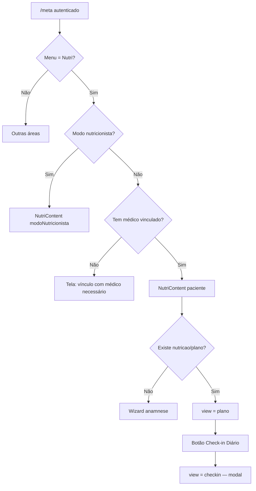
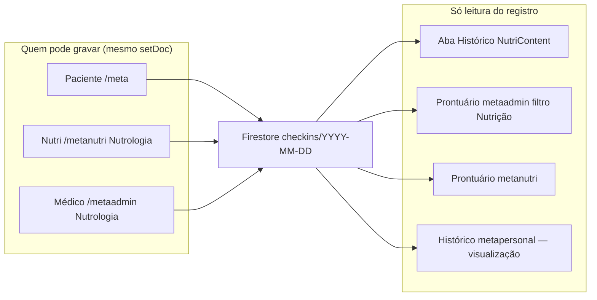

# Auditoria — Check-in Diário Nutri (`/meta` → Nutri)

**Escopo:** comportamento atual do botão **Check-in Diário** na página Nutri.  
**Fonte principal:** `components/NutriContent.tsx`  
**Data:** 2026-08-17  
**Nenhuma alteração de código nesta auditoria.**

Objetivo deste documento: base para converter o check-in nutricional de **diário** para **semanal**. Não misturar com o **Check-in semanal da aplicação** (Tirzepatida), que já existe e é outro fluxo.

---

## 0. Dois check-ins diferentes (não confundir)

| | Check-in Diário Nutri (este documento) | Check-in semanal da aplicação |
|--|----------------------------------------|-------------------------------|
| **Onde o paciente preenche** | `/meta` → menu **Nutri** → botão **Check-in Diário** | Fluxo de **aplicação semanal** (peso, circunferência, fome da semana, fotos) |
| **Componente** | `NutriContent` (`view === 'checkin'`) | Formulário de aplicação + `lib/aplicacao/checkInSemanalQuestions.ts` |
| **Perguntas** | Proteína, frutas, lixo, água, suplementos, GI, sono, humor, atividade, aderência ao plano, Tirzepatida do dia | Peso, circunferência, local da aplicação, fome da semana, água/proteína da semana, satisfação, comentário, fotos |
| **Persistência** | `pacientes_completos/{id}/nutricao/dados/checkins/{YYYY-MM-DD}` | `evolucaoSeguimento[]` no documento do paciente (campo `checkInSemanal`) |
| **Score** | `calcularScoreCheckIn` em `NutriContent.tsx` | `calcularScoreCheckInSemanal` em `lib/aplicacao/` |
| **Quem vê depois** | Aba Histórico do Nutri + timeline do prontuário (filtro Nutrição) | Timeline de aplicações (metaadmin / calendário / modal da aplicação) |

Converter o Nutri de diário → semanal **não substitui** o check-in da aplicação. São coletas paralelas, com perguntas e storage distintos.

---

## 1. Como o paciente chega no botão



Pré-requisitos no `/meta` paciente:

1. Conta autenticada.
2. Vínculo com médico (senão Nutri e Personal bloqueiam).
3. Plano nutricional gerado (`pacientes_completos/{id}/nutricao/plano`). Sem plano, o botão não aparece — a UI fica no wizard.

O botão **não** é uma rota HTTP. É um estado interno de `NutriContent` (`view: 'loading' | 'wizard' | 'plano' | 'checkin'`).

Rota isolada legado: `/meta/nutri` (`app/meta/nutri/page.tsx`) tem wizard/check-in próprio e **não é o fluxo principal**. Grava em caminho Firestore diferente (ver §6.3).

---

## 2. Onde o botão aparece (superfícies)

Tudo passa pelo mesmo componente: `NutriContent`. O rótulo na UI é sempre **Check-in Diário**.

### 2.1 Paciente — `/meta` (alvo da mudança)

| Item | Detalhe |
|------|---------|
| Arquivo | `app/meta/page.tsx` |
| Props | `<NutriContent paciente={...} />` — **sem** `modoNutricionista`, **sem** `somenteVisualizacao` |
| Botão | Verde, largura total no mobile (`w-full md:w-auto`), no topo da página do plano |
| Modal | Overlay tela cheia (`createPortal` em `document.body`, `z-[100]`) |

Este é o preenchimento **intencional** do produto: o paciente registra o próprio dia.

### 2.2 Nutricionista — `/metanutri`

| Entrada | Arquivo | Props relevantes |
|---------|---------|------------------|
| Modal paciente, aba Nutrologia (desktop, `embedded`) | `app/metanutri/page.v2.tsx` | `modoNutricionista` + `embedded` + `habilitarPlanosTemplates` |
| Modal Nutri mobile | `app/metanutri/page.v2.tsx` | `modoNutricionista` (sem `embedded`) |
| Página dedicada | `app/metanutri/nutri/[pacienteId]/page.tsx` | `modoNutricionista` |

No desktop embed, o botão fica no **menu lateral** (acima de Plano / Cardápio / Histórico / ChatNutri). No mobile, o mesmo botão verde do paciente.

**O nutricionista pode preencher e salvar o check-in.** `modoNutricionista` **não** bloqueia o botão nem `salvarCheckIn`. Só `somenteVisualizacao` esconde o botão.

Não há campo de autoria no documento salvo: o Firestore não registra se quem gravou foi paciente, nutri ou médico.

### 2.3 Médico — `/metaadmin`

Aba **Nutrologia** do modal do paciente (desktop e mobile) e o modal Nutri mobile usam o **mesmo** `NutriContent`:

```tsx
<NutriContent
  paciente={pacienteEditando}
  modoNutricionista
  embedded
  habilitarPlanosTemplates
  chatNutriAuthorKind="doctor"
/>
```

Consequência: o **médico também vê e pode clicar em Check-in Diário** e gravar no mesmo path do paciente. `chatNutriAuthorKind="doctor"` só vale para o ChatNutri, não para o check-in.

Leitura no prontuário (aba **Prontuário**, filtro Nutrição): o médico **vê** os check-ins já gravados, sem reabrir o modal de perguntas. Ver §8.

### 2.4 Personal — `/metapersonal`

```tsx
<NutriContent modoNutricionista embedded somenteVisualizacao />
```

- Botão **não aparece**.
- Se `view === 'checkin'`, mensagem: “Check-in Diário não está disponível neste modo.”
- Aba Histórico continua **somente leitura**.

### 2.5 Quem preenche de fato (resumo)

| Papel | Superfície | Pode abrir o modal? | Pode salvar? |
|-------|------------|---------------------|--------------|
| Paciente | `/meta` → Nutri | Sim (fluxo principal) | Sim |
| Nutricionista | `/metanutri` Nutrologia | Sim (mesmo botão) | Sim — **não há trava de papel** |
| Médico | `/metaadmin` Nutrologia | Sim (mesmo botão) | Sim — **não há trava de papel** |
| Personal | `/metapersonal` Nutrologia | Não (`somenteVisualizacao`) | Não |
| Qualquer autenticado | Firestore direto | — | Regras permitem `read, write` em `nutricao/{document=**}` |

`salvarCheckIn` só recusa se `somenteVisualizacao === true` ou se não houver `paciente.id`. Não checa UID do paciente.

---

## 3. O modal — shell e navegação

Não é um `<dialog>` nativo. É um painel escuro (`#0A1F44`) montado quando `view === 'checkin'`.

| Modo | Como renderiza |
|------|----------------|
| Padrão (`/meta`, metanutri sem embed, metaadmin modal mobile) | Overlay `fixed inset-0`, portal no `body`, clique fora fecha |
| `embedded` (modal paciente desktop metanutri/metaadmin) | Preenche a área de conteúdo; menu lateral continua visível com o item Check-in destacado |

Título no header: **Check-in Nutri** (o botão continua “Check-in Diário”).  
Subtítulo: “Escolha o dia (até 3 dias atrás).”

### 3.1 Seletor de data

- Input `type="date"`.
- Janela: **hoje até 3 dias atrás**. Futuro e >3 dias: `alert` + reset para hoje.
- Validação em `validarDataCheckIn`.
- Ao abrir, a data é forçada para **hoje** (`setCheckInDate(dataHoje)`).
- Se já existe documento para aquela data: `isEditandoCheckIn = true`.

**Comportamento atual de “edição” (divergente do FAQ/README):**

O formulário **some** quando já existe check-in (`{!isEditandoCheckIn && (...)}`). Aparece só o aviso:

> Check-in já realizado para esta data. Não é possível criar um novo check-in para esta data.

O código de `salvarCheckIn` ainda trata atualização (`setDoc` no mesmo ID + mensagem “atualizado”), mas a UI **não deixa chegar no Salvar**. FAQ (`components/FAQpaciente.tsx`) e `README_NUTRI.md` dizem que dá para editar até 3 dias atrás — isso **não é o que a UI faz hoje**.

### 3.2 Layout mobile vs desktop

Constante `CHECK_IN_MOBILE_STEPS` (5 etapas):

| # | `key` | Label curto | Título |
|---|-------|-------------|--------|
| 1 | `alimentacao` | Aliment. | Alimentação e proteína |
| 2 | `agua` | Água | Água e suplementos |
| 3 | `corpo` | Corpo | Corpo e bem-estar |
| 4 | `meta` | Meta | Metas do tratamento |
| 5 | `observacoes` | Notas | Observações |

- **Mobile (`sm:hidden`):** uma etapa por vez, barra de progresso, Anterior / Próximo. **Salvar** só na última etapa.
- **Desktop (`sm+`):** as 5 etapas no mesmo scroll (`hidden sm:block`). Cancelar + **Salvar check-in de hoje** no rodapé.

Ao entrar em `view === 'checkin'`, `document.body.style.overflow = 'hidden'`.

Após salvar: modal de sucesso (“Perfeito!”) → ao OK, `view = plano` e aba **Histórico**, com o dia do check-in selecionado no calendário.

---

## 4. Perguntas — o que o usuário preenche

Estado: `checkInData: CheckInDiario` (tipo local em `NutriContent.tsx`, não há Zod/API).

Padrões ao abrir um dia **sem** registro:

| Campo | Default |
|-------|---------|
| `proteinaOk`, `frutasOk`, `aguaOk` | `false` |
| `lixoAlimentar` | `true` (UI invertida: checkbox “Evitei lixos” desmarcado = não evitou) |
| suplementos | `false` |
| GI / náuseas / constipação / diarreia | `'nenhum'` |
| `horasSono` | `'6-8h'` |
| `humorEnergia` | `3` |
| `atividadeFisicaHoje` | `'nenhuma'` |
| `diaAplicacao` | `'nao_foi_dia'` |
| `aderenciaPlano` | `100` |
| resto | vazio / undefined |

Nenhuma pergunta é obrigatória: dá para salvar com os defaults.

### Etapa 1 — Alimentação e proteína

| UI | Campo | Tipo |
|----|-------|------|
| Bati a meta de proteína do dia | `proteinaOk` | checkbox |
| Comi frutas/vegetais conforme o plano | `frutasOk` | checkbox |
| Evitei lixos alimentares importantes | `lixoAlimentar` | checkbox **invertido**: marcado → `lixoAlimentar = false` |

**Calorias do cardápio de hoje** (não é pergunta): soma `macrosPorRefeicao` ou sugestão do plano. Grava `caloriasDiarias_kcal`. Aviso se fora de ~20–25 kcal/kg. O texto diz “hoje” mesmo se a data do check-in for retroativa.

### Etapa 2 — Água e suplementos

| UI | Campo |
|----|-------|
| Bebi pelo menos {metaAgua} de água hoje | `aguaOk` — meta vem de `plano.aguaDia_ml` (fallback “2-3 litros”) |
| Tomei a cápsula de probiótico hoje | `probioticoTomou` |
| Tomei o whey protein conforme orientado | `wheyTomou` |
| Tomei creatina hoje (3-5 g) | `creatinaTomou` |

### Etapa 3 — Corpo e bem-estar

Pills `nenhum | leve | moderado | grave`:

- Náuseas → `nauseas`
- Constipação → `constipacao`
- Diarreia → `diarreia`

Não existe pergunta “sintomas GI geral”. No save, `sintomasGI` = **pior** entre náuseas, constipação, diarreia e o `sintomasGI` já no estado.

Sono / humor:

- Horas de sono na última noite → `horasSono`: `<6h` \| `6-8h` \| `>8h`
- Humor / energia 1–5 → `humorEnergia`

### Etapa 4 — Metas do tratamento

**Aplicação da Tirzepatida (condicional):** só se `verificarSeHojeEDiaAplicacao()` for true.

- Critério: `paciente.planoTerapeutico.injectionDayOfWeek` === dia da semana de **hoje** (`new Date().getDay()`).
- **Não usa a data selecionada no date picker.** Check-in retroativo num dia que era de aplicação, feito num dia que não é, **esconde** o bloco. O inverso também: bloco aparece se *hoje* for dia de aplicação, mesmo preenchendo ontem.
- README_NUTRI cita `startDate`; o código atual **não** usa `startDate`.

Perguntas do bloco (quando visível):

- Como foi a aplicação? → `aplicou_no_horario` \| `aplicou_atrasado` \| `esqueceu`
- Local (se aplicou): `abdome` \| `coxa` \| `braco` \| `outro`

Se o bloco não aparece, o valor gravado permanece o default `nao_foi_dia`.

Sempre visível nesta etapa:

- Como foi sua atividade física hoje? → `nenhuma` \| `leve` \| `moderada` \| `intensa`
- Quanto você seguiu o plano nutricional hoje? → range 0–100, passo 5, atalhos 25/50/75/100 (`aderenciaPlano`)

**Peso de hoje (condicional):** se último peso em `evolucaoSeguimento` (ou inicial) tem **mais de 7 dias**, ou não há peso. Campo opcional `pesoHoje`. **Não** escreve de volta em `evolucaoSeguimento` — fica só no documento do check-in.

**Semana de aumento de dose (condicional):** se a última mudança em `planoTerapeutico.historicoDoses` foi há ≤7 dias. `sintomasAumentoDose`: `nenhum | leve | moderado | intenso`.

### Etapa 5 — Observações

Textarea: “Quer deixar alguma observação para o seu médico?” → `observacoes`.

---

## 5. Score (0–100, 1 casa decimal)

Calculado no cliente em `calcularScoreCheckIn` **antes** do `setDoc`. Não há recálculo no servidor.

| Bloco | Peso | Como pontua |
|-------|------|-------------|
| Aderência ao plano | 30% | `aderenciaPlano / 100` |
| Alimentação | 30% | 25% cada: proteína, frutas, água, **não** ter lixo (`!lixoAlimentar`) |
| Suplementos | 15% | 1/3 cada: probiótico, whey, creatina |
| Sintomas GI | 15% | Map `nenhum=1, leve=0.75, moderado=0.5, grave=0.25`; GI geral 40% + náuseas/constipação/diarreia 20% cada |
| Sono e energia | 5% | Sono `<6h=0.5, 6-8h=1, >8h=0.75` + `humorEnergia/5` |
| Atividade física | 3% | nenhuma=0, leve=0.5, moderada=0.75, intensa=1 |
| Adesão Tirzepatida | 2% | no horário=100, atrasado=70, esqueceu=0, `nao_foi_dia`=100 (não penaliza) |

No Histórico, faixa visual: score ≥80 verde, ≥60 amarelo, senão vermelho.

---

## 6. Persistência

Não existe API REST (`/api/...`) para este check-in. Leitura e escrita são **Firebase client** dentro de `NutriContent`.

### 6.1 Caminho canônico (fluxo atual)

```
pacientes_completos/{pacienteId}/nutricao/dados/checkins/{YYYY-MM-DD}
```

- ID do documento = data do check-in (`checkInDate`).
- Um documento por dia. `setDoc` substitui o documento inteiro.
- `timestamp: Timestamp.now()` na gravação (usado para `orderBy` na listagem).

Campos gravados:

```
proteinaOk, frutasOk, aguaOk, lixoAlimentar,
probioticoTomou, wheyTomou, creatinaTomou,
sintomasGI, nauseas, constipacao, diarreia,
horasSono, humorEnergia,
atividadeFisicaHoje,
diaAplicacao, localAplicacao,
observacoes, aderenciaPlano, pesoHoje, sintomasAumentoDose,
caloriasDiarias_kcal,
score, data, timestamp
```

**Não gravados:** autor (paciente/nutri/médico), `authorId`, semana de tratamento, intervalo da semana.

### 6.2 Leitura

`loadCheckIns`: `orderBy('timestamp', 'desc')`, páginas de 60. Histórico tem “carregar mais”.

Compatibilidade na leitura: campos novos defaultam se o doc for antigo.

### 6.3 Caminho legado (`/meta/nutri`)

`app/meta/nutri/page.tsx` grava em:

```
pacientes_completos/{id}/nutricao/checkins/{date}
```

(sem o documento intermediário `dados`). O `NutriContent` atual **não lê** esse path. Check-ins só da rota legado ficam invisíveis no Histórico e no prontuário.

### 6.4 Regras Firestore

```
match /pacientes_completos/{pacienteId} {
  allow read, write: if request.auth != null;
  match /nutricao/{document=**} {
    allow read, write: if request.auth != null;
  }
}
```

Qualquer usuário autenticado pode ler/escrever check-ins de qualquer paciente. Não há checagem de dono nem de papel.

---

## 7. Como o preenchimento é recarregado na UI Nutri

Aba **Histórico** (`activeTab === 'historico'`):

- Calendário mensal; dias com check-in marcados.
- Clique no dia → painel “Detalhes do dia”: score, aderência, alimentação, suplementos, GI, sono, humor, atividade, Tirzepatida, peso, calorias, observações.
- **Não** reabre o modal de perguntas a partir do calendário.
- Empty state: “Use o botão Check-in Diário para começar.”

Após salvar, o Histórico abre já no dia gravado (`historicoDatePendenteAbertura`).

---

## 8. Envolvimento de MetaNutri e MetaAdmin **depois** do preenchimento

O botão vive em `NutriContent`. MetaNutri e MetaAdmin entram de dois jeitos: **mesmo botão** (Nutrologia) e **leitura no prontuário**.



### 8.1 MetaAdmin — Nutrologia (botão)

`app/metaadmin/page.tsx`, pasta Nutrologia (`pastaAtiva === 3`) e modal Nutri mobile: `NutriContent` com `modoNutricionista` + `embedded`. O médico vê o botão **Check-in Diário** e pode gravar como se fosse o paciente.

Uso esperado do produto (pelo texto da aba): acompanhar cardápio, check-ins e ChatNutri. A trava de “só o paciente preenche” **não está implementada**.

### 8.2 MetaAdmin — Prontuário (sem botão)

`nutricaoProntuarioService.ts` → `buscarEventosNutricaoProntuario`:

- Lê a coleção `checkins` (até 90 mais recentes, ordenados por data).
- Cada doc vira evento de timeline:
  - `tipo: 'nutricao'`
  - `origem: 'paciente'` (fixo — mesmo se nutri/médico tiverem gravado)
  - título: **Check-in nutricional**
  - `dados.status`: **Check-in diário**
  - destaque: `Score N`
  - descrição: score, aderência, proteína/frutas/água, lixo, GI, humor, sono, peso, recorte de observações

Consumidores: `ProntuarioTab` (médico) e `carregarEventosAsyncProntuario` (também usado pelo prontuário nutri).

O card da timeline **não** reabre o modal de perguntas; é resumo.

### 8.3 MetaNutri — Nutrologia (botão)

Igual ao paciente, com `modoNutricionista`. Nutricionista edita plano/cardápio **e** pode lançar check-in.

### 8.4 MetaNutri — Prontuário (sem botão)

`ProntuarioNutriTab` carrega os mesmos eventos via `carregarEventosAsyncProntuario` (inclui check-ins). O nutricionista vê o histórico nutricional na timeline; o formulário do prontuário nutri (`ProntuarioNutriForm`) é consulta/nota própria (`origem: 'nutri'`), **não** é o modal Check-in Diário.

Placeholder do form de adesão: “Check-ins, uso do app Nutri, ChatNutri, barreiras…” — texto livre do profissional, não o questionário do paciente.

### 8.5 O que MetaNutri / MetaAdmin **não** fazem neste botão

- Não há cron, WhatsApp ou e-mail disparado ao salvar o check-in Nutri.
- Não há sincronização automática para a subcoleção `timeline` (a Etapa 03 do prontuário nutri é opcional e não está ligada ao save).
- Não há indicador “último check-in” / “dias com check-in (30d)” no topo do prontuário (Etapa 04 opcional, não entregue).
- ChatNutri é paralelo: cota/conversa em `chatNutri/{date}`; não alimenta o documento de check-in.

---

## 9. Pontos que a conversão diário → semanal precisa decidir

1. **Identidade do documento.** Hoje o ID é `YYYY-MM-DD`. Semanal precisa de chave de semana (ex. ISO week, ou data de início da semana) e política se o paciente puder atualizar a mesma semana.
2. **Janela de preenchimento.** Hoje: hoje + 3 dias retroativos, sem futuro. Semanal: semana corrente? semana anterior? várias semanas em aberto?
3. **Edição.** UI atual bloqueia segundo envio no mesmo ID. Semanal provavelmente precisa permitir completar/editar a semana.
4. **Redação das perguntas.** Quase todas dizem “hoje” / “do dia” / “última noite”. Semanal exige copy e, em vários campos, escala (ex. atividade da semana, não do dia).
5. **Score.** Pesos e mapas são diários (suplemento “tomou hoje”, Tirzepatida “foi dia de aplicação”). Semanal pode colidir conceitualmente com o score do check-in da **aplicação**.
6. **Tirzepatida neste modal vs aplicação.** O bloco de aplicação no Nutri usa o dia da semana de *hoje*. A aplicação semanal já coleta local/peso/fome. Risco de duplicar adesão ao medicamento.
7. **Quem grava.** Paciente, nutri e médico compartilham o mesmo `setDoc` sem autoria. Se o semanal for “do paciente”, falta trava por papel nas três superfícies (`/meta`, `/metanutri`, `/metaadmin`).
8. **Prontuário.** `dados.status: 'Check-in diário'` e um card por documento. Semanal: um card por semana; textos e `origem: 'paciente'` precisam ser revisados.
9. **Histórico.** Calendário diário. Semanal pede visão por semana ou manter dias mas com um registro só.
10. **Legado.** `/meta/nutri` e path `nutricao/checkins/{date}` ficam órfãos se só o `NutriContent` mudar.
11. **FAQ / README / landing.** Ainda descrevem check-in diário e edição em 3 dias — desatualizados em parte já hoje.

---

## 10. Arquivos de referência

| Arquivo | Papel |
|---------|--------|
| `components/NutriContent.tsx` | Botão, modal, perguntas, score, save, Histórico |
| `app/meta/page.tsx` | Paciente (e modo nutri) monta `NutriContent` |
| `app/metanutri/page.v2.tsx` | Nutrologia + prontuário nutri |
| `app/metanutri/nutri/[pacienteId]/page.tsx` | Página nutri dedicada |
| `app/metaadmin/page.tsx` | Nutrologia do modal do paciente |
| `app/metapersonal/page.v2.tsx` | Nutri só leitura (`somenteVisualizacao`) |
| `app/metaadmin/components/paciente-modal/prontuario/nutricaoProntuarioService.ts` | Check-ins → timeline |
| `app/metaadmin/components/paciente-modal/prontuario/ProntuarioTab.tsx` | Prontuário médico |
| `app/metaadmin/components/paciente-modal/prontuario/ProntuarioNutriTab.tsx` | Prontuário nutricionista |
| `app/meta/nutri/page.tsx` | Legado; outro path Firestore |
| `firestore.rules` | `nutricao/{document=**}` autenticado |
| `lib/aplicacao/checkInSemanalQuestions.ts` | **Outro** check-in (aplicação semanal) |
| `components/FAQpaciente.tsx` / `README_NUTRI.md` | Descrição desatualizada (edição) |

Auditoria irmã (anamnese, não check-in): `docs/nutri/AUDITORIA_ANAMNESE_NUTRICIONAL_METANUTRI.md` §2.11.
