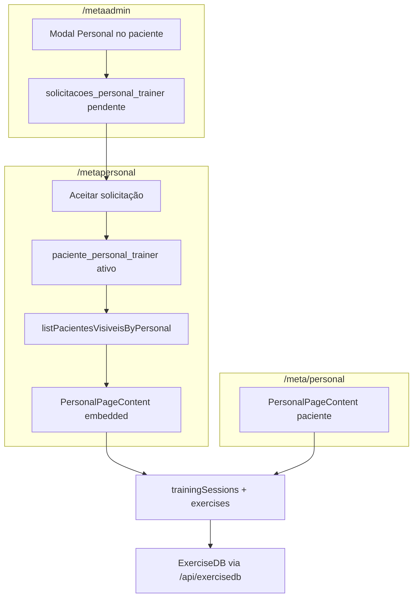

# Auditoria: Plano de Treino — `/meta`, `/metaadmin` e `/metapersonal`

**Data:** 2026-07-26  
**Escopo:** análise somente leitura do código existente. Nenhuma alteração de código, regras, Firestore ou APIs foi feita.  
**Fonte de verdade:** implementação atual no repositório (não docs legados, quando divergirem).

---

## Sumário executivo

O “Plano de Treino” **não é um documento único** chamado `planoTreino`. Na prática, o sistema usa **sessões de treino** em Firestore:

- Collection: `trainingSessions`
- Subcollection: `trainingSessions/{sessionId}/exercises`
- Preferências de lembrete: `trainingReminderPrefs/{patientId}`

O fluxo de compartilhamento é:

```txt
Médico vincula-se a um personal (pré-requisito)
→ Médico compartilha o paciente (solicitação pendente)
→ Personal aceita no /metapersonal
→ Vínculo ativo em paciente_personal_trainer
→ Paciente aparece na lista do personal
→ Personal abre PersonalPageContent (mesmo componente do /meta/personal)
→ Personal cria/edita sessões de treino
→ Paciente vê e executa as sessões em /meta/personal
```

**Achados críticos:**

1. A restrição “personal só altera Plano de Treino” é **quase só de UI**. As regras do Firestore exigem apenas `request.auth != null`.
2. O personal **também consegue editar bioimpedância e pagamentos** no `/metapersonal` (fora do Plano de Treino).
3. O **paciente também cria, edita e exclui treinos** na mesma interface (`PersonalPageContent`). Não há modo “somente execução” para o paciente.
4. Não existe modelo de **evolução de carga** (peso/kg). A prescrição é apenas `sets`, `reps`, `restSec`.
5. A documentação antiga `INTEGRACAO_METAPERSONAL_META_PERSONAL.md` descreve redirect para `/meta/personal?pacienteId=`. O código vivo embute a UI em `/metapersonal?view=personal&pacienteId=`.

---

## 1. Página Personal no `/meta`

### 1.1 Arquivos relacionados

| Caminho | Papel |
| --- | --- |
| `app/meta/personal/page.tsx` | Fonte principal: `PersonalPageContent` + rota `/meta/personal` |
| `app/meta/page.tsx` | Menu Personal redireciona para `/meta/personal` |
| `app/meta/layout.tsx` | Layout do portal paciente |
| `types/trainingSession.ts` | Tipos `TrainingSession`, `TrainingSessionExercise`, `TrainingReminderPrefs` |
| `types/exercise.ts` | Shape ExerciseDB |
| `services/trainingSessionService.ts` | CRUD Firestore das sessões |
| `services/pacientePersonalTrainerService.ts` | Vínculo paciente↔personal |
| `services/personalTrainerService.ts` | Perfil do personal |
| `features/metaPersonal/metaPersonal.constants.ts` | Collections e status |
| `features/metaPersonal/metaPersonal.types.ts` | Tipos de vínculo/solicitação |
| `data/exerciseTranslations.ts` | Traduções PT de nome/grupo/equipamento |
| `app/api/exercisedb/*` | Proxy ExerciseDB (imagem, busca, filtros, tradução) |
| `app/api/exercises/*` | Proxy alternativo/legado de exercícios |
| `services/exerciseDbService.ts` | Cliente `/api/exercises` (pouco usado na página Personal; a UI chama `/api/exercisedb/*` diretamente) |
| `components/CalendarioTreinosPersonal.tsx` | Calendário usado no metaadmin/metapersonal (não no shell `/meta`) |

Não há hooks dedicados (`useTraining…`). O carregamento é feito com `useCallback`/`useEffect` dentro de `PersonalPageContent`.

### 1.2 Como o paciente acessa

1. Login Firebase no `/meta`.
2. Menu lateral / bottom nav **Personal**.
3. `app/meta/page.tsx` faz `router.replace('/meta/personal')` quando `activeMenu === 'personal'`.
4. A página abre em **fullscreen**, fora do shell principal do Meta.

**Gate:** se o paciente não tiver `medicoResponsavelId`, a UI bloqueia com mensagem de vínculo com médico necessário.

### 1.3 Como o plano atual é carregado

Não há “plano ativo” separado. A UI carrega **sessões** por data/intervalo:

| Função | Serviço |
| --- | --- |
| `loadPaciente` | `PacienteService.getPacienteByEmail` (modo paciente) |
| `loadTodaySession` | `getSessionsForDate` + `getSessionExercises` |
| `loadWeekSessionMarkers` | sessões da semana |
| `loadCalendarSessions` | mês/semana no cronograma |
| `loadHistorico` | ~60 dias |
| `loadEstatisticas` | aderência 7d/30d |
| `loadReminderPrefs` | `trainingReminderPrefs` |

Chave usada nas queries de sessão: preferencialmente `paciente.userId`, com fallback para `pacienteId` da query ou `user.uid`. Há fallback adicional quando `userId` tem formato `uid_timestamp` (tenta UID base).

### 1.4 Identificadores

| Identificador | Uso |
| --- | --- |
| `user.uid` | Auth do paciente; fallback de `patientId` |
| `paciente.id` | ID do documento em `pacientes_completos` |
| `paciente.userId` | **Chave principal** em `trainingSessions.patientId` |
| `createdById` | UID de quem criou a sessão |
| `personalTrainerId` | UID do personal no vínculo |

### 1.5 Exibição de treinos, dias e exercícios

Abas internas: `hoje` | `cronograma` | `criar` | `historico` | `estatisticas` | `config`.

- **Hoje:** chips Seg–Dom; sessões da data; cards de exercício (GIF, nome, tags, `sets×reps`, descanso); progresso % por exercícios `done`.
- **Cronograma:** calendário mês/semana com marcadores de treino.
- **Criar:** busca ExerciseDB + montagem da sessão + publicação única ou recorrente.
- **Histórico / Estatísticas / Config:** histórico, aderência, lembretes e timer de descanso.

Treinos futuros (`scheduledDate > hoje`) não abrem detalhes: toast “Treino agendado — disponível no dia”.

### 1.6 Ações do paciente (implementadas)

**Pode:**

- Criar, editar e excluir sessões e exercícios
- Criar recorrência (semanal / personalizada por dias da semana)
- Marcar exercício como **Feito / Pulou / desfazer**
- Rodar modo treino (timer, descanso, carrossel)
- Salvar `patientNotes` na sessão
- Configurar lembretes e preferências locais de timer
- Ver GIF, instruções e tradução PT

**Não pode (pelo código atual):**

- Usar Personal sem médico responsável
- Abrir sessão futura antes do dia
- Registrar carga/peso por série (campo inexistente)
- Ter um “plano” com ativação/encerramento formal distinto de sessões

### 1.7 Mídia e instruções

- Mídia principal: **GIF** via `/api/exercisedb/image?exerciseId=…&resolution=360` (thumbs 180).
- Não há player de vídeo dedicado.
- Detalhes: `GET /api/exercisedb/exercise?id=` + `POST /api/exercisedb/translate-details` → `descriptionPt` / `instructionsPt`.
- Nomes/grupos traduzidos por `data/exerciseTranslations.ts`.

### 1.8 Conclusão, histórico e evolução

| Recurso | Existe? | Como |
| --- | --- | --- |
| Conclusão por exercício | Sim | `status: 'done' \| 'skipped'` + `completedAt` |
| Conclusão por sessão | Parcial | Campo `session.status` existe; UI principal marca por exercício (`markSession` quase não usado na página) |
| Histórico | Sim | Aba Histórico + calendário + eventos no prontuário admin |
| Evolução de carga | **Não** | Sem campo de peso/carga na prescrição |
| Feedback estruturado | Parcial | `patientNotes` texto livre |

---

## 2. Compartilhamento pelo `/metaadmin`

### 2.1 Onde acontece

Tudo embutido em `app/metaadmin/page.tsx` (não há componentes separados):

| UI | Função |
| --- | --- |
| Botão dumbbell no card do paciente | Abre modal Personal |
| Modal `showModalPersonal` | Status do compartilhamento, Encerrar, calendário |
| Modal `showModalBuscarPersonalTrainer` | Seleciona personal elegível e cria solicitação |
| Menu **Personal** / Vínculos | Vínculo médico↔personal (pré-requisito) |

### 2.2 Seleção do personal

O médico **não busca personal livremente** no modal de compartilhamento atual. A lista vem de `loadPersonalTrainersElegiveis`:

- `isVerificado === true`
- `status === 'ativo'`
- `medicoVinculadoIds.includes(medicoPerfil.id)`

Identificador salvo do personal: `personal.userId` (Firebase Auth UID = doc id em `personal_trainers`).

Identificador do paciente: `pacientePersonalSelecionado.id` (`pacientes_completos`).

Também salva `medicoId` (`medicos` doc id).

`organizationId` é escrito via `shadowOrganizationFields()` (valor shadow `'metodo'`), **sem filtro operacional** nas queries de compartilhamento.

### 2.3 Convite vs vínculo direto

Não é vínculo direto. Fluxo:

1. Médico chama `SolicitacaoPersonalTrainerService.createPacienteShareRequest` → `solicitacoes_personal_trainer` com `status: 'pendente'`.
2. Personal vê em Solicitações Pendentes no `/metapersonal`.
3. Personal aceita → `approveShareRequest` → cria `paciente_personal_trainer/{pacienteId}_{personalTrainerId}` com `status: 'ativo'`.
4. Ou rejeita → `rejeitada`.
5. Médico pode cancelar pendente → `cancelada`.

**Notificação:** o personal **não recebe e-mail** ao ser compartilhado (só lista in-app). Ao aceitar, o sistema envia e-mail ao **paciente** (`POST /api/send-email-solicitado-personal`).

### 2.4 Status

**Solicitação** (`SOLICITACAO_STATUS`): `pendente` | `aceita` | `rejeitada` | `cancelada` | `aguardando_medico` (definido; metaadmin share UI usa principalmente `pendente`).

**Vínculo ativo:** `ativo` | `inativo` | `removido` (encerramento usa `inativo`).

### 2.5 Encerramento

| Ação | Quem | Efeito |
| --- | --- | --- |
| Cancelar pendente | Médico | `cancelShareRequest` |
| Encerrar ativo | Médico ou personal | `endCompartilhamento` → vínculo `inativo` + delete das solicitações relacionadas |
| Remover vínculo médico↔personal | Médico | remove vínculo de equipe e limpa compartilhamentos de pacientes |

Após encerrar, o paciente deixa de aparecer em `listPacientesVisiveisByPersonal` (só vínculos `ativo`). As sessões de treino **permanecem** em `trainingSessions` (não são apagadas no encerramento).

### 2.6 Múltiplos personais / troca

- **Modelo de dados:** permite múltiplos (`pacienteId_personalTrainerId`).
- **UI metaadmin:** se já existe vínculo ativo, oculta o formulário de novo compartilhamento e mostra Encerrar — na prática, **um por vez** na interface, embora o modelo suporte mais.

### 2.7 Fluxo técnico completo

```txt
Pré-requisito: vínculo médico↔personal aceito
  (solicitacoes_vinculo_personal_medico → medicoVinculadoIds / personalTrainerVinculadoIds)

Médico abre modal Personal no paciente
→ seleciona personal elegível (userId)
→ createPacienteShareRequest
→ Firestore: solicitacoes_personal_trainer { status: pendente }
→ (sem e-mail ao personal)

Personal abre /metapersonal → Pacientes → Solicitações Pendentes
→ approveShareRequest
→ valida personal.medicoVinculadoIds inclui medicoId
→ solicitação status=aceita
→ cria paciente_personal_trainer/{pacienteId}_{personalTrainerId} status=ativo
→ e-mail ao paciente

listPacientesVisiveisByPersonal(user.uid)
→ paciente aparece na lista
→ botão dumbbell → /metapersonal?view=personal&pacienteId=...
```

### 2.8 Arquivos do compartilhamento

- `app/metaadmin/page.tsx`
- `services/solicitacaoPersonalTrainerService.ts`
- `services/solicitacaoVinculoPersonalMedicoService.ts`
- `services/pacientePersonalTrainerService.ts`
- `services/personalTrainerService.ts`
- `features/metaPersonal/metaPersonal.constants.ts`
- `features/metaPersonal/metaPersonal.types.ts`
- `app/api/send-email-solicitado-personal/route.ts`
- `app/api/send-email-personal-pediu-vinculo/route.ts` (vínculo médico↔personal, não share de paciente)
- `lib/organization/shadowOrganizationId.ts`

Não há API REST de CRUD do compartilhamento: tudo é **client SDK → Firestore**.

---

## 3. Portal `/metapersonal`

### 3.1 Rotas

| Rota | Arquivo |
| --- | --- |
| `/metapersonal` | `app/metapersonal/page.tsx` → força `page.v2.tsx` |
| UI completa | `app/metapersonal/page.v2.tsx` |
| Layout/OG | `app/metapersonal/layout.tsx` |

Não há subrotas App Router. Navegação interna por estado/menu + query:

- Menus: `home` | `medicos` | `pacientes` | `financeiro` | `calendario` | `meu-perfil`
- Treino: `?view=personal&pacienteId={id}`

Middleware trata `/metapersonal` como rota operacional, **sem gate de auth** no middleware.

### 3.2 Login e identidade

1. Login Google/Firebase (fora do portal).
2. `onAuthStateChanged`; sem user → redirect `/`.
3. `PersonalTrainerService.getPersonalTrainerByUserId(uid)` → `personal_trainers/{uid}`.
4. Sem doc → `ProfissionalCadastroGateModal`.
5. `isVerificado !== true` → `MetaNutriPersonalWizard` bloqueia até verificação admin.

Identidade = Firebase Auth UID.

### 3.3 Pacientes compartilhados

- `PacientePersonalTrainerService.listPacientesVisiveisByPersonal(uid)`
- Base: vínculos `paciente_personal_trainer` com `status == 'ativo'`
- Carrega `PacienteCompleto` completo via `PacienteService.getPacienteById`

Pendências: `listPendingRequestsByPersonal` → Aceitar / Recusar.

### 3.4 Abertura do paciente e seções

No card do paciente:

| Botão | Comportamento |
| --- | --- |
| Visualizar | Modal read-only (Identificação + Dados Clínicos) |
| Aplicações | Expande `evolucaoSeguimento` (visualização) |
| Exames | Viewer de lab |
| Bioimpedância | Viewer; **pode salvar** registros |
| Prescrições | Botão **desabilitado** |
| Nutrição | Modal plano/check-ins/estatísticas/chat |
| Personal (dumbbell) | `?view=personal&pacienteId=` |
| Cancelar compartilhamento | Encerrar vínculo |

Também: gráficos, controle de pagamentos personal–paciente, simulador de IMC no card.

### 3.5 Como o Plano de Treino é acessado

```txt
Card do paciente → Dumbbell
→ /metapersonal?view=personal&pacienteId={paciente.id}
→ <PersonalPageContent fromMetapersonalEmbedded />
→ isPersonalTrainerMode = true (via ?pacienteId=)
```

A interface de treino **é a mesma** do `/meta/personal` (componente compartilhado).

Identificação do paciente visualizado: query `pacienteId` (doc id Firestore), depois sessões usam `paciente.userId`.

---

## 4. Visibilidade dos dados do paciente

O personal carrega o documento completo `PacienteCompleto`, mas a UI expõe subconjuntos. A tabela abaixo reflete o que a **interface** mostra/permite.

| Informação | Personal visualiza? | Personal altera? | Origem do dado | Arquivo responsável |
| --- | ---: | ---: | --- | --- |
| Nome | Sim | Não (UI) | `dadosIdentificacao.nomeCompleto` / `nome` | `page.v2.tsx` modal Visualizar |
| Email / telefone / CPF | Sim | Não (UI) | `dadosIdentificacao.*` | idem |
| Data nascimento / idade | Sim (data; idade derivável) | Não (UI) | `dadosIdentificacao.dataNascimento` | idem |
| Sexo biológico | Sim | Não (UI) | `dadosIdentificacao.sexoBiologico` | idem |
| Endereço | Sim | Não (UI) | `dadosIdentificacao.endereco` | idem |
| Status do tratamento | Sim | Não (UI) | `statusTratamento` | idem |
| Peso / altura / IMC iniciais | Sim | Não (UI) | `dadosClinicos.medidasIniciais` | modal + card |
| Circunferência abdominal | Sim | Não (UI) | `medidasIniciais.circunferenciaAbdominal` | modal |
| Evolução do peso | Sim | Não (UI) | `evolucaoSeguimento[].peso` | card / Aplicações / Gráficos |
| Objetivo do tratamento | Parcial | Não | Existe em `dadosClinicos.objetivosTratamento`; **não listado** no modal Visualizar atual | tipo em `types/obesidade.ts` |
| Composição corporal | Sim | **Sim (bioimpedância)** | `bioimpedanciaRegistros` | `BioImpedanciaDisplay` + `salvarBioImpedanciaRegistros` |
| Medicações | Sim | Não (UI) | `dadosClinicos.medicacoesUsoAtual` | modal Dados Clínicos |
| Diagnósticos / comorbidades | Sim | Não (UI) | `diagnosticoPrincipal`, `comorbidades` | modal |
| Alergias | Sim | Não (UI) | `dadosClinicos.alergias` | modal |
| Limitações físicas / dor / lesões | Não como campo dedicado | — | Há `perfilMetabolicoV3.atividadeFisica.dificuldades.dor` e estilo de vida, mas **não exibidos** no modal Visualizar | tipos em `obesidade.ts` |
| Aplicações | Sim | Não (UI) | `evolucaoSeguimento` | botão Aplicações |
| Exames laboratoriais | Sim | Não (UI) | `examesLaboratoriais` | viewer |
| Plano nutricional | Sim | Não (plano); chat pode escrever | `pacientes_completos/{id}/nutricao/plano` | modal Nutrição + `NutriContent` |
| Prescrições médicas | Não (botão bloqueado) | Não | — | UI disabled |
| Plano de treino (sessões) | Sim | **Sim** | `trainingSessions` | `PersonalPageContent` |
| Histórico de execução | Sim | Não marca feito/pulou | exercises.status | `PersonalPageContent` |
| Pagamentos personal–paciente | Sim | **Sim** | serviço de pagamentos | `page.v2.tsx` financeiro |
| Médico responsável | Sim | Não | vínculo + `MedicoService` | lista / header treino |

> **Conclusão de produto vs código:** a intenção “personal só modifica Plano de Treino” **não está totalmente garantida**. Na UI, bioimpedância e pagamentos também são editáveis. No backend (Firestore), qualquer autenticação autenticada pode escrever nas collections relevantes.

---

## 5. Permissões de edição

### 5.1 Camadas

| Camada | O que faz |
| --- | --- |
| Auth Firebase | Exige usuário logado no portal |
| Perfil `personal_trainers` | Identifica personal; `isVerificado` libera listas |
| Vínculo ativo | Filtra pacientes visíveis na lista |
| Frontend UI | Bloqueia formulários clínicos, prescrições, mark done, reminders |
| Soft-check em `PersonalPageContent` | Verifica vínculo, mas **não bloqueia de forma hard** se veio com `pacienteId` |
| API routes | Não autorizam CRUD de treino (cliente fala com Firestore) |
| `firestore.rules` | `allow read, write: if request.auth != null` (fallback global) |

Trecho relevante de `firestore.rules`:

```javascript
match /pacientes_completos/{pacienteId} {
  allow read, write: if request.auth != null;
  match /nutricao/{document=**} {
    allow read, write: if request.auth != null;
  }
}
match /{document=**} {
  allow read, write: if request.auth != null;
}
```

Não há matchers específicos para `trainingSessions`, `paciente_personal_trainer` ou `personal_trainers`.

### 5.2 Riscos de segurança observados

1. Personal autenticado pode abrir `/meta/personal?pacienteId=…` ou `/metapersonal?view=personal&pacienteId=…` e a autorização é permissiva (warn, não deny).
2. Qualquer usuário autenticado poderia, via cliente Firestore, alterar `pacientes_completos` ou `trainingSessions` de outros IDs.
3. Revogação do vínculo remove o paciente da **lista**, mas não impede tecnicamente escrita residual se o UID/IDs forem conhecidos (rules não checam vínculo).

### 5.3 Matriz de acesso (comportamento da UI atual)

Legenda: V = visualizar · C = criar · E = editar · X = excluir · — = sem acesso na UI

| Área | Paciente | Médico | Nutricionista | Personal |
| --- | ---: | ---: | ---: | ---: |
| Dados cadastrais | V/E (próprios, fluxo Meta) | V/C/E | V (portal nutri) | V |
| Dados médicos / anamnese | V/E (chat/anamnese) | V/C/E | V | V |
| Aplicações | V/registro check-in | V/C/E | V | V |
| Plano nutricional | V/execução | V | V/C/E | V (+ chat) |
| Bioimpedância | V | V/E | V/E | **V/E** |
| Prescrições | V | V/C/E | — | — (bloqueado) |
| Plano de treino (sessões) | **V/C/E/X** | V (prontuário/eventos) | — | **V/C/E/X** |
| Histórico de treino | V + marcar feito/pulou | V (eventos) | — | V (sem marcar feito) |
| Lembretes de treino | V/E | — | — | V (sem salvar) |
| Pagamentos personal | — | — | — | V/C/E |

Diferença treino paciente vs personal:

- Paciente: cria/edita **e** marca execução.
- Personal: cria/edita **e não** marca execução / não altera reminders.

---

## 6. Funcionamento atual do Plano de Treino

### 6.1 Modelo mental real

Não há entidade “plano A/B/C” com ativação. O que existe são **sessões datadas** (`scheduledDate`), opcionalmente ligadas por `recurrenceGroupId`.

### 6.2 Tabela de funcionalidades

| Funcionalidade | Existe? | Arquivo | Como funciona |
| --- | ---: | --- | --- |
| Criar plano (sessão) | Sim | `app/meta/personal/page.tsx` + `trainingSessionService` | Aba Criar → `handleCreateSession` → `createSessionWithExercises` |
| Editar plano | Sim | idem | `handleEditSavedSession` carrega exercícios; republica e deleta IDs antigos |
| Excluir plano/sessão | Sim | idem | `handleDeleteSession` / grupo recorrente |
| Duplicar plano | Não como ação explícita | — | — |
| Ativação/encerramento formal | Não | — | Usa `published: true` e `status` da sessão |
| Organização por dias | Sim | UI + `scheduledDate` | Uma ou N sessões por data |
| Treino A/B/C | Não estruturado | — | Pode existir só no `title` texto livre |
| Frequência semanal | Sim (recorrência) | `handleCreateSession` / `generateSessionDates` | weekly / custom dias + semanas |
| Data de início | Sim | `newSessionDate` | Início da série |
| Data de término | Implícita | — | Calculada por semanas/datas geradas |
| Objetivo do plano | Não tipado | — | Só título/notas |
| Exercícios | Sim | subcollection `exercises` | Source ExerciseDB |
| Grupos musculares | Sim | `bodyPart`, `target` | Da ExerciseDB |
| Séries | Sim | `prescription.sets` | number |
| Repetições | Sim | `prescription.reps` | number |
| Carga (kg) | **Não** | — | — |
| Intervalo | Sim | `prescription.restSec` | segundos |
| Duração do treino | Parcial | timer de execução | Não prescrita no doc |
| Intensidade | Não | — | — |
| Observações paciente | Sim | `patientNotes` | Texto |
| Observações trainer | Tipo existe (`trainerNotes`) | `types/trainingSession.ts` | Pouco/nenhum uso na UI de criação atual |
| Instruções | Sim | ExerciseDB + translate | Sob demanda |
| Vídeos | Não (GIF) | `/api/exercisedb/image` | GIF animado |
| Links externos | Não | — | — |
| Ordenação | Sim | `order` | Índice na criação |
| Reordenar na UI | Parcial | ordem = ordem da lista selecionada | Sem drag-and-drop dedicado auditado como feature |
| Substituir exercício | Manual | — | Remover + adicionar |
| Exercícios personalizados (fora ExerciseDB) | Não | `source: 'exercisedb'` fixo | — |
| Registro de execução | Sim | `markExercise` | Feito/Pulou |
| Histórico | Sim | aba Histórico | Sessões passadas |
| Evolução de carga | **Não** | — | — |
| Feedback do paciente | Parcial | `patientNotes` | Livre |

---

## 7. Estrutura de dados do Plano de Treino

### 7.1 Collections em uso

```txt
trainingSessions/{sessionId}
  └── exercises/{exerciseDocId}

trainingReminderPrefs/{patientId}

paciente_personal_trainer/{pacienteId}_{personalTrainerId}
solicitacoes_personal_trainer/{autoId}
personal_trainers/{userId}
solicitacoes_vinculo_personal_medico/{autoId}
pacientes_completos/{pacienteId}
```

### 7.2 Tipos TypeScript (`types/trainingSession.ts`)

```ts
export type TrainingSessionStatus = 'scheduled' | 'done' | 'skipped';

export interface TrainingSessionExercise {
  id?: string;
  source: 'exercisedb';
  exerciseId: string;
  name: string;
  bodyPart: string;
  target: string;
  equipment: string;
  gifUrl?: string;
  prescription: {
    sets: number;
    reps: number;
    restSec: number;
  };
  order: number;
  status?: 'done' | 'skipped';
  completedAt?: Date | string;
}

export interface TrainingSession {
  id?: string;
  patientId: string;
  createdBy: 'patient' | 'trainer'; // runtime também grava 'personal_trainer'
  createdById: string;
  scheduledDate: string; // YYYY-MM-DD
  title: string;
  status: TrainingSessionStatus;
  patientNotes?: string;
  trainerNotes?: string;
  published: boolean;
  recurrenceGroupId?: string;
  updatedAt: Date | string;
  createdAt: Date | string;
  revision?: number;
}
```

### 7.3 Exemplo fiel ao payload de criação (código atual)

```ts
{
  patientId: "uidOuUid_timestamp",
  createdBy: "personal_trainer", // ou "patient"
  createdById: "<authUid>",
  scheduledDate: "2026-07-28",
  title: "Treino Superior",
  status: "scheduled",
  published: true,
  recurrenceGroupId: "rec_…", // opcional
  createdAt: Timestamp,
  updatedAt: Timestamp,
  // subcollection exercises:
  // {
  //   source: "exercisedb",
  //   exerciseId: "0001",
  //   name: "...",
  //   bodyPart: "...",
  //   target: "...",
  //   equipment: "...",
  //   gifUrl: "/api/exercisedb/image?exerciseId=0001&resolution=360",
  //   prescription: { sets: 3, reps: 10, restSec: 60 },
  //   order: 0
  // }
}
```

### 7.4 Estruturas antigas vs atuais

| Item | Status |
| --- | --- |
| ID vínculo `pacienteId_personalTrainerId` | Atual |
| ID legado `pacienteId_personalTrainerId_medicoId` | Compatibilidade em `endCompartilhamento` |
| `createdBy: 'personal_trainer'` vs tipo `'trainer'` | Divergência tipo/runtime |
| Docs de “plano de treino” monolítico | Não encontrado na implementação viva |
| Spec `data/SISTEMA_PERSONAL_PACIENTE.md` / rules aspiracionais | Descrevem ACL mais rígida; **não refletida** em `firestore.rules` |

---

## 8. Fluxo de salvamento

```txt
Personal abre paciente no /metapersonal
→ clica dumbbell
→ /metapersonal?view=personal&pacienteId=...
→ PersonalPageContent (isPersonalTrainerMode)
→ aba Criar / editar sessão salva
→ preenche título, data, recorrência, exercícios (sets/reps/rest)
→ botão de publicar/criar (handleCreateSession)
→ valida título/data/≥1 exercício; se recurring, dias
→ se editingSessionIds, confirma substituição
→ monta exercisesData (source exercisedb + prescription + gifUrl)
→ generateSessionDates(...)
→ loop: trainingSessionService.createSessionWithExercises(...)
→ se edição: deleteSession dos IDs antigos
→ alert sucesso; limpa form; reload calendário/hoje
→ paciente em /meta/personal lê as mesmas trainingSessions por patientId=userId
```

Detalhes:

| Item | Implementação |
| --- | --- |
| Botão | UI da aba Criar em `PersonalPageContent` |
| Função | `handleCreateSession` |
| Validações | Campos obrigatórios + recorrência + soft `authorizationError` |
| Serviço | `trainingSessionService.createSessionWithExercises` |
| API route de save | **Não existe** (Firestore client direto) |
| Operação | `writeBatch` set session + exercises |
| Erros | `try/catch` + `alert` |
| Loading | `creatingSession` |
| Sucesso | `alert` + refresh local |
| Listener realtime | **Não**; reloads manuais após ações |
| Atualização paciente | Próximo load/query das sessões no `/meta/personal` |

---

## 9. Reutilização entre `/meta` e `/metapersonal`

| Aspecto | Situação |
| --- | --- |
| Componente principal | **Um só:** `PersonalPageContent` em `app/meta/personal/page.tsx` |
| Embed metapersonal | `fromMetapersonalEmbedded` + query `pacienteId` |
| Props reais | `embedded`, `pacienteProp`, `fromMetapersonalEmbedded` |
| Props inexistentes | `readOnly`, `professionalMode`, `viewerRole` |
| Diferenciação de modo | `isPersonalTrainerMode = !!pacienteId` na query |
| Estrutura de dados | Idêntica (`trainingSessions`) |
| Salvamento | Funções compartilhadas no mesmo arquivo/serviço |
| Risco de divergência | Baixo para a tela de treino (single source); alto se alguém reintroduzir modal legado em `page.v2.tsx` (há código morto de modal Personal antigo) |

Arquivos a preservar em evolução futura:

- `app/meta/personal/page.tsx`
- `services/trainingSessionService.ts`
- `types/trainingSession.ts`
- `app/api/exercisedb/*`
- Serviços de vínculo em `services/*Personal*`
- Embed em `app/metapersonal/page.v2.tsx`

---

## 10. Biblioteca de exercícios

### 10.1 Origem

Biblioteca externa **ExerciseDB (RapidAPI)**, via proxies Next:

- `app/api/exercisedb/search|byBodyPart|byTarget|byEquipment|bodyparts|targets|equipments|exercise|image|translate-details`
- Alternativo: `app/api/exercises/*` + `services/exerciseDbService.ts`

Não há collection Firestore de catálogo próprio de exercícios.

### 10.2 Campos disponíveis (tipo `Exercise`)

`id`, `name`, `bodyPart`, `target`, `equipment`, `secondaryMuscles[]`, `instructions[]`, `description?`, `difficulty?`, `category?`, `gifUrl?`.

### 10.3 Pesquisa e filtros na UI

- Busca por nome
- Filtros bodyPart / target / equipment
- Traduções locais PT
- Detalhes sob demanda + tradução Gemini/API de translate-details (já existente para instruções, **não** para montar plano)

### 10.4 Como um exercício entra no plano

1. Personal/paciente busca na aba Criar.
2. Seleciona exercício e define `sets`, `reps`, `restSec`.
3. Ao publicar, o exercício é **copiado** para a subcollection da sessão (snapshot denormalizado), não fica só como referência viva.

Exercícios custom criados pelo personal: **não implementados**.

---

## 11. Dados disponíveis para geração simples por IA

Dados já existentes no paciente (`PacienteCompleto`) relevantes para rascunho de treino:

| Dado | Existe? | Collection/campo | Já é carregado no metapersonal? | Seria seguro enviar à IA? |
| --- | ---: | --- | ---: | ---: |
| Idade | Sim (via nascimento) | `dadosIdentificacao.dataNascimento` | Sim (modal) | Sim (idade, sem data completa) |
| Sexo | Sim | `dadosIdentificacao.sexoBiologico` | Sim | Sim |
| Peso | Sim | `medidasIniciais.peso` / evolução | Sim | Sim |
| Altura | Sim | `medidasIniciais.altura` | Sim | Sim |
| IMC | Sim | `medidasIniciais.imc` | Sim | Sim |
| Evolução do peso | Sim | `evolucaoSeguimento[].peso` | Sim (card/gráficos) | Sim (resumo: inicial/atual/Δ) |
| Objetivo tratamento | Sim | `dadosClinicos.objetivosTratamento` | Parcial (não no modal Visualizar) | Sim (flags resumidas) |
| Composição corporal | Sim | `bioimpedanciaRegistros` | Sim | Parcial (só resumo % gordura/massa, se existir) |
| Nível de atividade | Sim | `estiloVida.atividadeFisica` / V3 | Carregado no doc; **não mostrado** no modal Visualizar | Sim |
| Limitações / dor | Parcial | `perfilMetabolicoV3.atividadeFisica.dificuldades` | Não na UI Visualizar | Sim, se perguntado/confirmado |
| Lesões específicas | Não estruturado | — | Não | Perguntar |
| Doenças/comorbidades | Sim | `comorbidades`, diagnóstico | Sim | **Cuidado** — minimizar; só flags relevantes a exercício |
| Medicamentos | Sim | `medicacoesUsoAtual` | Sim | **Evitar** no MVP (dado sensível, pouco útil à montagem inicial) |
| Local de treino | Não | — | Não | Perguntar |
| Equipamentos | Não no paciente | — | Não | Perguntar |
| Dias disponíveis | Não | — | Não | Perguntar |
| Tempo por treino | Não | — | Não | Perguntar |
| Experiência | Não | — | Não | Perguntar (nível) |
| Preferências / evitados | Não | — | Não | Perguntar |

**Recomendação de payload mínimo para IA:** idade, sexo, IMC/peso atual, nível de atividade (se houver), objetivo de treino (pergunta), dias/semana, duração, local/equipamentos, limitações declaradas no formulário curto. **Não** enviar prontuário completo, medicações, exames, chat ou anamnese inteligente.

---

## 12. Proposta de IA simples (não implementada)

Fluxo desejado, alinhado ao código atual:

```txt
Personal em /metapersonal?view=personal&pacienteId=...
→ aba Criar do PersonalPageContent
→ “Gerar sugestão com IA”
→ revisa resumo (idade/sexo/IMC/atividade)
→ responde perguntas mínimas
→ 1 chamada Gemini → JSON no shape das sessões atuais
→ preenche selectedExercises + título + datas (rascunho em memória)
→ personal revisa
→ handleCreateSession (salvamento manual existente)
→ paciente vê em /meta/personal
```

Regras de produto:

- Sem autonomia contínua
- Sem chat permanente
- Sem alteração automática sem salvar
- Sem ampliar permissões do personal
- Botão **apenas** no modo personal (`isPersonalTrainerMode`), nunca no app do paciente nesta fase

---

## 13. Perguntas mínimas para o personal

| Pergunta | Já existe no sistema? | Precisa perguntar? |
| --- | ---: | ---: |
| Objetivo do treino | Parcial (objetivos clínicos de emagrecimento) | **Sim** (objetivo de treino: hipertrofia/condicionamento/mobilidade etc.) |
| Dias por semana | Não | **Sim** |
| Duração por treino | Não | **Sim** |
| Local (casa/academia) | Não | **Sim** |
| Equipamentos | Não no paciente; catálogo ExerciseDB tem equipment | **Sim** (lista curta) |
| Nível atual | Parcial (`estiloVida.atividadeFisica`) | Confirmar / perguntar se ausente |
| Limitações ou dores | Parcial (V3) | **Sim** (confirmação explícita) |
| Exercícios a evitar | Não | **Sim** (texto curto opcional) |

Manter formulário ≤ 7 perguntas.

---

## 14. Estrutura esperada do retorno da IA (compatível com o modelo real)

Deve mapear para o que `handleCreateSession` já consome: título + datas/recorrência + lista de exercícios com prescription.

```ts
{
  title: string;
  sessionType: "single" | "recurring";
  startDate: string; // YYYY-MM-DD
  recurrence?: {
    frequency: "weekly" | "custom";
    weeksCount?: number;
    timesPerWeek?: number;
    daysOfWeek?: number[]; // 0=domingo … 6=sábado
  };
  exercises: Array<{
    exerciseId: string; // ExerciseDB id
    name: string;
    bodyPart: string;
    target: string;
    equipment: string;
    prescription: {
      sets: number;
      reps: number;
      restSec: number;
    };
  }>;
  notesForTrainer?: string; // só UI; não obrigatório salvar
}
```

Após o retorno, a UI deve:

1. Resolver `gifUrl` com helpers existentes.
2. Preencher estados `newSessionTitle`, `newSessionDate`, `selectedExercises`, flags de recorrência.
3. **Não** chamar `createSessionWithExercises` automaticamente.

Se a IA sugerir `exerciseId` inválido, o personal deve poder trocar pelo buscador ExerciseDB atual.

---

## 15. Controle de consumo da API (proposta)

- Chamada **somente** após clique explícito
- Uma chamada por geração
- Nenhuma chamada ao abrir a página
- Regenerar só com confirmação (“substituir rascunho?”)
- Manter rascunho em estado React até salvar/descartar
- Opcional: salvar último JSON gerado em estado local/`localStorage` por `pacienteId` (sem nova collection nesta fase)
- Limite soft (ex.: N gerações/dia/personal) se necessário
- Enviar só campos essenciais (seção 11)
- Resposta JSON curta (sem prosa)
- Modelo Gemini de menor custo compatível com structured output

Não implementar nesta auditoria.

---

## 16. MVP recomendado

1. Botão **“Gerar sugestão com IA”** na aba Criar de `PersonalPageContent`, visível só se `isPersonalTrainerMode`.
2. Modal com resumo do paciente (idade/sexo/IMC/atividade) + formulário curto (seção 13).
3. Uma chamada a uma futura API route (ex. `/api/metapersonal/gerar-treino`) autenticada.
4. Validação de vínculo ativo no **backend** da geração (melhoria necessária; hoje o save do treino não tem API).
5. Preencher rascunho nos estados atuais do formulário.
6. Badge/estado visual “rascunho — não salvo”.
7. Personal edita normalmente.
8. Salvamento manual via `handleCreateSession` existente.
9. Paciente continua vendo/executando em `/meta/personal`.
10. Sem jobs, sem regeneração automática, sem mudança de permissões.
11. Paciente **não** vê o botão nesta fase.

### Arquivos que futuramente precisariam ser modificados (lista previsível)

- `app/meta/personal/page.tsx` (UI do botão + preenchimento do form)
- Nova API route de geração (ainda inexistente)
- Possivelmente `services/trainingSessionService.ts` apenas se houver status `draft` (opcional; MVP pode ficar só em memória)
- **Fortemente recomendado em paralelo (segurança):** `firestore.rules` para escopo de personal/paciente em `trainingSessions` e `pacientes_completos` — hoje é risco real

---

## 17. Arquitetura atual (visão consolidada)



---

## 18. Riscos técnicos e de segurança

| Risco | Severidade | Evidência |
| --- | --- | --- |
| Firestore sem ACL por papel/vínculo | Alta | `firestore.rules` auth-only |
| Soft-check de vínculo no treino | Alta | comentários/fluxo permissivo em `PersonalPageContent` |
| Personal edita bioimpedância e pagamentos | Média | UI em `page.v2.tsx` |
| Paciente também edita o plano | Média/Produto | Sem `readOnly` no paciente |
| Divergência `createdBy` tipo vs runtime | Baixa | `'personal_trainer'` vs `'trainer'` |
| `patientId` inconsistente (`uid` vs `uid_timestamp`) | Média | Fallbacks espalhados no load |
| Docs legados desatualizados | Baixa | `INTEGRACAO_METAPERSONAL_…` vs embed atual |
| Sem realtime | Baixa | Paciente pode ver treino novo só após refresh/load |
| Dados sensíveis no doc completo carregado pelo personal | Média | `getPacienteById` retorna prontuário inteiro mesmo com UI parcial |

---

## 19. Índice de arquivos-chave

### Treino / UI

- `app/meta/personal/page.tsx`
- `app/meta/page.tsx`
- `app/metapersonal/page.tsx`
- `app/metapersonal/page.v2.tsx`
- `app/metapersonal/layout.tsx`
- `components/CalendarioTreinosPersonal.tsx`

### Serviços / tipos

- `services/trainingSessionService.ts`
- `services/pacientePersonalTrainerService.ts`
- `services/solicitacaoPersonalTrainerService.ts`
- `services/solicitacaoVinculoPersonalMedicoService.ts`
- `services/personalTrainerService.ts`
- `types/trainingSession.ts`
- `types/exercise.ts`
- `types/obesidade.ts`
- `features/metaPersonal/*`

### Admin

- `app/metaadmin/page.tsx` (modais de compartilhamento)

### Exercícios

- `app/api/exercisedb/**`
- `app/api/exercises/**`
- `data/exerciseTranslations.ts`

### Segurança

- `firestore.rules`

### Docs relacionados (podem divergir do código)

- `INTEGRACAO_METAPERSONAL_META_PERSONAL.md`
- `data/SISTEMA_PERSONAL_PACIENTE.md`
- `data/oftware_meta_paciente_personal_spec_v1.md`
- `docs/MAP_ROTAS_HOME_META_METANUTRI_METAPERSONAL_ADMIN.md`

---

## 20. Veredito final

O sistema atual já cobre ponta a ponta o fluxo médico → personal → paciente para **sessões de treino** com biblioteca ExerciseDB, recorrência, execução pelo paciente e reutilização total da UI entre `/meta/personal` e `/metapersonal`.

Para evoluir com IA simples, o encaixe natural é a aba **Criar** de `PersonalPageContent` em modo personal, preenchendo o formulário existente e salvando pelo fluxo manual atual.

Antes ou junto do MVP de IA, o maior gap não é de UX de treino: é de **segurança e aderência à regra de negócio** (“personal só altera Plano de Treino”), hoje garantida principalmente pela interface e não pelas rules/API.
