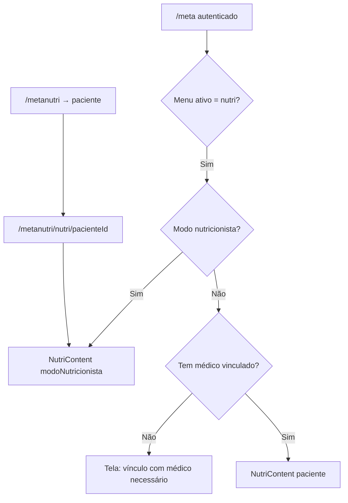
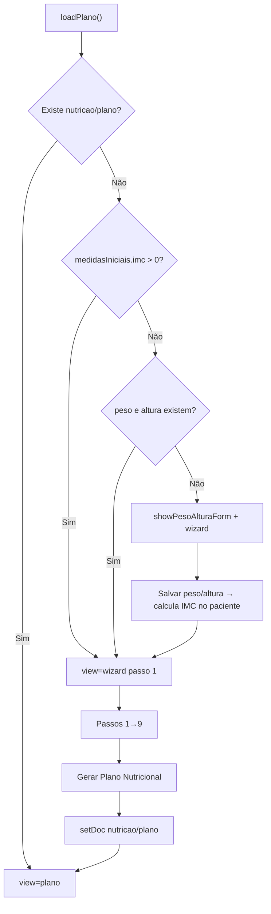
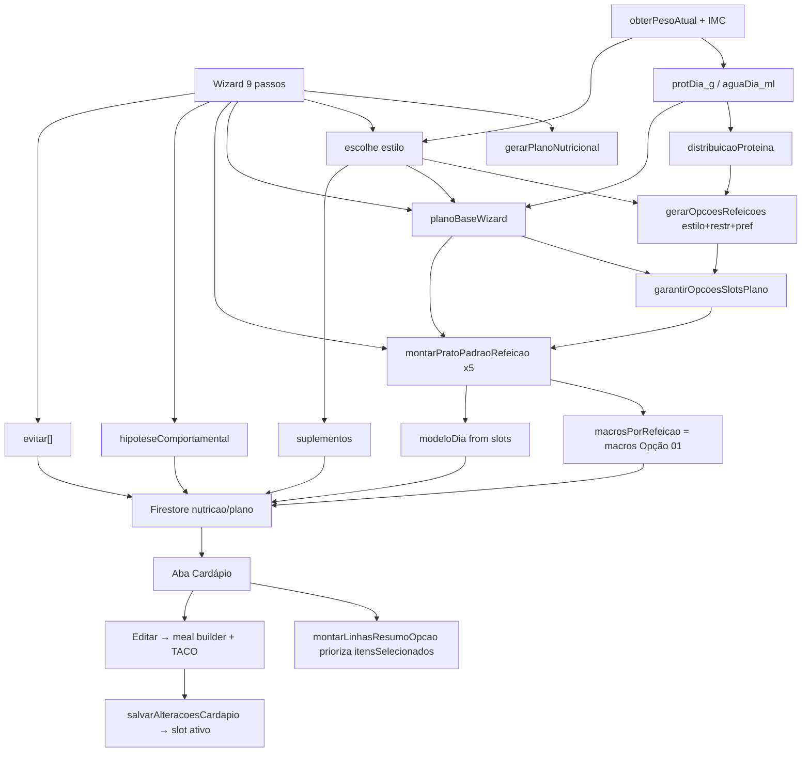

# Auditoria da Anamnese Nutricional — MetaNutri

**Escopo:** documentação do comportamento atual.  
**Fonte principal:** `components/NutriContent.tsx`  
**Entradas de UI:** `/meta` (menu Nutri), `/metanutri/nutri/[pacienteId]`, legado `app/meta/nutri/page.tsx`  
**Data da auditoria:** 2026-07-31  

Nenhuma alteração de código foi feita nesta auditoria.

---

# 1. Fluxo completo

## 1.1 Como o paciente chega na Nutri



| Entrada | Arquivo | Componente |
|---------|---------|------------|
| Paciente no Meta | `app/meta/page.tsx` (~5978) | `<NutriContent paciente={...} />` |
| Nutricionista no Meta | `app/meta/page.tsx` (~5940) | `<NutriContent modoNutricionista />` |
| MetaNutri por paciente | `app/metanutri/nutri/[pacienteId]/page.tsx` | `<NutriContent modoNutricionista />` |
| Legado isolado | `app/meta/nutri/page.tsx` | Wizard próprio de 6 passos (não é o fluxo principal atual) |

Pré-requisito no Meta paciente: vínculo com médico (senão Nutri/Personal bloqueiam).

## 1.2 Estados internos de `NutriContent` (`view`)

| `view` | Significado |
|--------|-------------|
| `loading` | Lendo Firestore `pacientes_completos/{id}/nutricao/plano` |
| `wizard` | Anamnese nutricional (9 passos) ou formulário peso/altura |
| `plano` | Plano gerado + abas (Plano Nutri, Cardápio, Histórico, ChatNutri) |
| `checkin` | Check-in diário (modal/fluxo separado) |

## 1.3 Jornada até finalizar a anamnese



### Gate peso/altura (antes do wizard)

- **Tela:** “Informações Básicas”
- **Campos:** Peso (kg) *, Altura (cm) *
- **Ação:** `handleSalvarPesoAltura`
- **Persistência:** `pacientes_completos/{id}` → `dadosClinicos.medidasIniciais.{peso,altura,imc}`
- **Cálculo:** `imc = peso / (altura_m²)`

### Wizard — 9 passos (ordem)

| Passo | Título na UI | Conteúdo |
|------:|--------------|----------|
| 1 | Objetivo Principal | Objetivo do acompanhamento |
| 2 | Rotina e Jornada de Trabalho | Horário de trabalho + horas sentado |
| 3 | Histórico de Peso e Dietas | Dietas 12 meses, sanfona, pesos máx/mín 2 anos |
| 4 | Padrão de Fome e Saciedade | Fome matinal/noturna, vontade de doce, pular café, fome no jantar |
| 5 | Padrão de Atividade Física | Frequência de AF + horas de sono |
| 6 | Sono e Cronotipo | Horário de dormir + acorda descansado |
| 7 | Padrão Alimentar | Nº refeições, comportamentos, fome emocional, compulsão noturna |
| 8 | Álcool e Finais de Semana | Doses/semana + sai da dieta no fim de semana |
| 9 | Preferências e Restrições + Sintomas GI | Restrições, preferências de proteína, sintomas GI |

Navegação: **Anterior** / **Próximo**; no passo 9 o botão vira **Gerar Plano Nutricional** → `gerarPlanoNutricional()`.

### Após o plano

Abas em `view === 'plano'`:

1. **Plano Nutri** — estilo, hipótese, metas proteína/água, suplementos, lista “evitar”
2. **Cardápio** — 5 refeições × Opções 01–05, Editar (meal builder + TACO), impressão
3. **Histórico** — check-ins salvos
4. **ChatNutri** — `ChatNutriPanel` (conversa/foto de refeição; não lê o wizard bruto)

Check-in diário: `view === 'checkin'`, 5 etapas mobile (`CHECK_IN_MOBILE_STEPS`).

---

# 2. Todas as perguntas existentes

## 2.0 Observação crítica de persistência

O objeto `WizardData` **não é salvo** como documento próprio no Firestore.

Na geração do plano, só entram no documento `nutricao/plano` os campos derivados / selecionados (ver §3).  
Respostas do wizard que não forem convertidas em `estilo`, `evitar`, `hipoteseComportamental`, `restricoesPaciente`, `preferenciasProteinaPaciente` etc. **deixam de existir** após o reload (exceto peso/altura/IMC no paciente).

Validação de obrigatoriedade: o wizard **não bloqueia** avanço por campo vazio; usa defaults do `useState`. Só peso/altura no gate pré-wizard exigem preenchimento (`disabled={!peso || !altura}`).

---

## 2.1 Gate — Informações básicas

### Campo: `dadosClinicos.medidasIniciais.peso`

| | |
|--|--|
| **Pergunta** | Peso (kg) * |
| **Tipo** | number |
| **Opções** | livre (min 20, max 400, step 0.1) |
| **Obrigatório** | sim (neste form) |
| **Padrão** | valor existente ou `null` |
| **Salvo em** | `pacientes_completos/{id}.dadosClinicos.medidasIniciais.peso` |
| **Utilização** | IMC; `obterPesoAtual` (fallback); `protDia_g`; `aguaDia_ml`; meta kcal do check-in |

### Campo: `dadosClinicos.medidasIniciais.altura`

| | |
|--|--|
| **Pergunta** | Altura (cm) * |
| **Tipo** | number |
| **Opções** | livre (min 120, max 230) |
| **Obrigatório** | sim (neste form) |
| **Padrão** | valor existente ou `null` |
| **Salvo em** | `...medidasIniciais.altura` |
| **Utilização** | cálculo de IMC no save |

### Campo derivado: `dadosClinicos.medidasIniciais.imc`

| | |
|--|--|
| **Pergunta** | (não perguntado; calculado) |
| **Tipo** | number |
| **Salvo em** | `...medidasIniciais.imc` |
| **Utilização** | fator g/kg de proteína; escolha de estilo `rico_proteina` se ≥ 32; gate do wizard |

---

## 2.2 Wizard passo 1 — Objetivo

### Campo: `objetivoPrincipal` (`WizardData`)

| | |
|--|--|
| **Pergunta** | Qual é o seu principal objetivo com o acompanhamento nutricional? |
| **Tipo** | select (botões) |
| **Valores** | `perda_peso`, `recomposicao`, `controle_glicemia`, `melhora_disposicao`, `manutencao` |
| **Labels** | Perda de Peso / Recomposição Corporal / Controle Glicêmico / Melhora de Disposição / Manutenção |
| **Obrigatório** | não (sempre tem valor) |
| **Padrão** | `perda_peso` |
| **Persistido como wizard?** | não |
| **Utilização** | Se `recomposicao` → contribui para `estilo = rico_proteina`. Demais valores **não alteram** lógica além do default `low_carb_moderada` quando outras regras não batem. |

---

## 2.3 Wizard passo 2 — Rotina

### Campo: `horarioTrabalho`

| | |
|--|--|
| **Pergunta** | Qual é o seu horário de trabalho? |
| **Tipo** | select |
| **Valores** | `diurno`, `noturno`, `turnos` |
| **Padrão** | `diurno` |
| **Persistido?** | não |
| **Utilização** | **Nenhuma** após coleta |

### Campo: `horasSentado`

| | |
|--|--|
| **Pergunta** | Quantas horas por dia você passa sentado? |
| **Tipo** | select |
| **Valores** | `<4h`, `4-8h`, `>8h` (labels: Menos de 4 / 4 a 8 / Mais de 8) |
| **Padrão** | `4-8h` |
| **Persistido?** | não |
| **Utilização** | **Nenhuma** |

---

## 2.4 Wizard passo 3 — Histórico de peso/dietas

### Campo: `dietaUltimos12Meses`

| | |
|--|--|
| **Pergunta** | Já fez alguma dieta nos últimos 12 meses? |
| **Tipo** | select `sim` \| `nao` |
| **Padrão** | `nao` |
| **Utilização** | Só controla exibição de `tipoDieta`. **Não** entra em estilo/hipótese/evitar |

### Campo: `tipoDieta`

| | |
|--|--|
| **Pergunta** | Qual tipo de dieta? |
| **Tipo** | texto |
| **Obrigatório** | não |
| **Padrão** | `''` |
| **Utilização** | **Nenhuma** (só UI condicional) |

### Campo: `efeitoSanfona`

| | |
|--|--|
| **Pergunta** | Teve efeito sanfona (ganhou e perdeu peso várias vezes)? |
| **Tipo** | select `sim` \| `nao` |
| **Padrão** | `nao` |
| **Utilização** | `gerarHipoteseComportamental` se `sim` |

### Campo: `kgSanfona`

| | |
|--|--|
| **Pergunta** | Aproximadamente quantos kg de variação? |
| **Tipo** | number |
| **Condicional** | se `efeitoSanfona === 'sim'` |
| **Utilização** | Texto da hipótese (`~Xkg`) |

### Campo: `pesoMaximo2Anos`

| | |
|--|--|
| **Pergunta** | Peso máximo dos últimos 2 anos (kg) |
| **Tipo** | number opcional |
| **Utilização** | **Nenhuma** |

### Campo: `pesoMinimo2Anos`

| | |
|--|--|
| **Pergunta** | Peso mínimo dos últimos 2 anos (kg) |
| **Tipo** | number opcional |
| **Utilização** | **Nenhuma** |

---

## 2.5 Wizard passo 4 — Fome/saciedade

### Campo: `fomeMatinal`

| | |
|--|--|
| **Pergunta** | Fome matinal (0 = sem fome, 10 = fome extrema) |
| **Tipo** | range 0–10 |
| **Padrão** | `5` |
| **Utilização** | **Nenhuma** |

### Campo: `fomeNoturna`

| | |
|--|--|
| **Pergunta** | Fome noturna (0–10) |
| **Tipo** | range 0–10 |
| **Padrão** | `5` |
| **Utilização** | Hipótese se `>= 7` |

### Campo: `vontadeDoce`

| | |
|--|--|
| **Pergunta** | Vontade de doce (0–10) |
| **Tipo** | range 0–10 |
| **Padrão** | `5` |
| **Utilização** | Hipótese se `>= 7` |

### Campo: `pulaCafeManha`

| | |
|--|--|
| **Pergunta** | Costuma pular café da manhã? |
| **Tipo** | boolean (checkbox) |
| **Padrão** | `false` |
| **Utilização** | Hipótese |

### Campo: `chegaComMuitaFomeJantar`

| | |
|--|--|
| **Pergunta** | Costuma chegar com MUITA fome no jantar? |
| **Tipo** | boolean |
| **Padrão** | `false` |
| **Utilização** | Hipótese |

---

## 2.6 Wizard passo 5 — Atividade e sono (horas)

### Campo: `atividadeFisica`

| | |
|--|--|
| **Pergunta** | Com que frequência você pratica atividade física regularmente? |
| **Tipo** | select |
| **Valores** | `nunca`, `1-2x`, `3-4x`, `5-7x` |
| **Padrão** | `nunca` |
| **Utilização** | Estilo `mediterranea` (com comportamentos); hipótese comportamental |

### Campo: `sonoHoras`

| | |
|--|--|
| **Pergunta** | Quantas horas de sono você tem por noite? |
| **Tipo** | select `<6h` \| `6-8h` \| `>8h` |
| **Padrão** | `6-8h` |
| **Utilização** | Sempre entra no texto da hipótese |

---

## 2.7 Wizard passo 6 — Sono/cronotipo

### Campo: `horarioDormir`

| | |
|--|--|
| **Pergunta** | Horário em que costuma dormir |
| **Tipo** | select `22-00` \| `00-02` \| `depois_02h` |
| **Padrão** | `22-00` |
| **Utilização** | **Nenhuma** |

### Campo: `acordaDescansado`

| | |
|--|--|
| **Pergunta** | Acorda descansado? |
| **Tipo** | select `sim` \| `as_vezes` \| `nao` |
| **Padrão** | `as_vezes` |
| **Utilização** | Hipótese se `nao` |

---

## 2.8 Wizard passo 7 — Padrão alimentar

### Campo: `numeroRefeicoesDia`

| | |
|--|--|
| **Pergunta** | Quantas refeições você faz por dia? |
| **Tipo** | select `2-3` \| `4-5` \| `>5` |
| **Padrão** | `4-5` |
| **Utilização** | **Nenhuma** (plano sempre `refeicoes: 5`) |

### Campo: `comportamentosAlimentares`

| | |
|--|--|
| **Pergunta** | Selecione todos os comportamentos que se aplicam a você |
| **Tipo** | checkbox multi |
| **Valores** | `pulo refeições`, `como rápido`, `belisco o dia todo`, `doce diário`, `álcool frequente` |
| **Padrão** | `[]` |
| **Utilização** | Estilo `mediterranea` (3 primeiros + AF nunca); `evitar` se `álcool frequente`. `doce diário` **não** tem regra própria |

### Campo: `fomeEmocional`

| | |
|--|--|
| **Pergunta** | Fome Emocional — Você come quando está ansioso, estressado ou triste? |
| **Tipo** | boolean |
| **Padrão** | `false` |
| **Utilização** | **Nenhuma** |

### Campo: `compulsaoNoturna`

| | |
|--|--|
| **Pergunta** | Compulsão Noturna — episódios à noite? |
| **Tipo** | boolean |
| **Padrão** | `false` |
| **Utilização** | `evitar.push('refeições pesadas após 20h')` |

---

## 2.9 Wizard passo 8 — Álcool / fim de semana

### Campo: `dosesAlcoolSemana`

| | |
|--|--|
| **Pergunta** | Quantas doses de álcool por semana? |
| **Tipo** | select `0` \| `1-3` \| `4-7` \| `>7` |
| **Padrão** | `0` |
| **Utilização** | `evitar` se `4-7` ou `>7`; hipótese se `>7` |

### Campo: `finalSemanaSaiDieta`

| | |
|--|--|
| **Pergunta** | Final de semana costuma sair da dieta? |
| **Tipo** | select `quase_nunca` \| `as_vezes` \| `sempre` |
| **Padrão** | `quase_nunca` |
| **Utilização** | `evitar` + hipótese se `sempre` |

---

## 2.10 Wizard passo 9 — Restrições / preferências / GI

### Campo: `restricoes` → salvo como `restricoesPaciente`

| | |
|--|--|
| **Pergunta** | Restrições alimentares (selecione todas que se aplicam) |
| **Tipo** | checkbox multi |
| **Valores** | `vegetariano`, `vegano`, `intolerância lactose`, `sem glúten`, `nada` |
| **Padrão** | `[]` |
| **Persistido** | `plano.restricoesPaciente` |
| **Utilização** | Estilo `plant_based`; filtro catálogo builder; filtro `gerarOpcoesRefeicoes`; `montarPratoPadraoRefeicao`; `evitar` lactose/glúten; UI Plano |

### Campo: `preferenciasProteina` → `preferenciasProteinaPaciente`

| | |
|--|--|
| **Pergunta** | Preferências de proteína (selecione todas que você consome) |
| **Tipo** | checkbox multi |
| **Valores** | `Carne`, `Frango`, `Peixe`, `Ovos`, `Laticínios`, `Leguminosas` |
| **Padrão** | `[]` |
| **Persistido** | `plano.preferenciasProteinaPaciente` |
| **Utilização** | Ordenação/seleção proteína em `gerarOpcoesRefeicoes` e `montarPratoPadraoRefeicao`; UI Plano |

### Campo: `sintomasGI` (wizard)

| | |
|--|--|
| **Pergunta** | Você apresenta sintomas gastrointestinais com frequência? (...) |
| **Tipo** | select `nenhum` \| `leve` \| `moderado` \| `grave` |
| **Padrão** | `nenhum` |
| **Persistido como wizard?** | não |
| **Utilização** | Se `moderado`/`grave` → `estilo = digestiva` (prioridade máxima na árvore de estilo) |

---

## 2.11 Check-in diário (`CheckInDiario`)

Persistido em: `pacientes_completos/{id}/nutricao/dados/checkins/{YYYY-MM-DD}`  
(coleção sob o documento `nutricao/dados`; não faz parte da anamnese inicial, mas é coleta Nutri contínua.)

| Campo | Pergunta UI (aprox.) | Tipo | Padrão | Uso |
|-------|----------------------|------|--------|-----|
| `proteinaOk` | Bati a meta de proteína do dia | boolean | false | score + histórico |
| `frutasOk` | Comi frutas/vegetais conforme o plano | boolean | false | score + histórico |
| `lixoAlimentar` | Evitei lixos alimentares (UI invertida) | boolean | false | score (`!lixo`) |
| `aguaOk` | Bebi pelo menos {metaAgua} de água hoje | boolean | false | score |
| `probioticoTomou` | Tomei a cápsula de probiótico | boolean | false | score |
| `wheyTomou` | Tomei o whey conforme orientado | boolean | false | score |
| `creatinaTomou` | Tomei creatina (3–5 g) | boolean | false | score |
| `sintomasGI` | Sintomas GI do dia | select severidade | nenhum | score GI |
| `nauseas` | Náuseas | select | nenhum | score |
| `constipacao` | Constipação | select | nenhum | score |
| `diarreia` | Diarreia | select | nenhum | score |
| `horasSono` | Horas de sono | select | 6-8h | score |
| `humorEnergia` | Humor/energia 1–5 | number | 3 | score |
| `atividadeFisicaHoje` | Atividade hoje | select | nenhuma | score |
| `diaAplicacao` | Adesão Tirzepatida do dia | select | nao_foi_dia | score |
| `localAplicacao` | Local da aplicação | select opcional | — | armazenamento/histórico |
| `aderenciaPlano` | Quanto seguiu o plano (%) | range 0–100 | 100 | score 30% |
| `pesoHoje` | Peso de hoje (condicional) | number? | — | armazenamento |
| `sintomasAumentoDose` | Sintomas em aumento de dose | select? | — | armazenamento |
| `caloriasDiarias_kcal` | (derivado do cardápio na UI) | number? | — | salvo no check-in |
| `observacoes` | Notas livres | texto | '' | armazenamento |
| `score` | (calculado) | number | — | histórico |
| `data` | data do check-in | string YYYY-MM-DD | — | id doc |

Etapas mobile do check-in: Aliment. → Água → Corpo → Meta → Notas.

---

# 3. Estrutura dos dados

## 3.1 Onde vivem os tipos

Todos os tipos Nutri principais estão **locais** em `components/NutriContent.tsx` (não há schema Zod/Prisma separado para Nutri):

- `RefeicaoKey`, `ItemRefeicao`, `ConfiguracaoRefeicao`, `OpcaoRefeicao`
- `PlanoNutricional`
- `CheckInDiario`
- `WizardData`
- `PacienteCompleto` (externo: `@/types/obesidade`) — peso/altura/IMC/evolução

## 3.2 Firestore

| Caminho | Conteúdo |
|---------|----------|
| `pacientes_completos/{pacienteId}` | Paciente; `dadosClinicos.medidasIniciais`; `evolucaoSeguimento` (peso atual) |
| `pacientes_completos/{id}/nutricao/plano` | Documento único `PlanoNutricional` |
| `pacientes_completos/{id}/nutricao/dados/checkins/{date}` | Check-ins diários (subcoleção de `nutricao/dados`) |
| `pacientes_completos/{id}/usage/chatNutri_{date}` | Cota de imagens ChatNutri (fora da anamnese) |

**Coleção paralela não usada pelo fluxo Meta atual:** `nutri_planos` (`services/nutriPlanoService.ts` — classe sem call sites no repo).

**Não existe** hoje: `nutricao/anamnese`, `nutricao/wizard`, ou API REST dedicada ao plano (leitura/escrita via Firebase client no componente).

### Prop `modoNutricionista`

Declarada em `NutriContentProps` e passada pelas entradas MetaNutri/Meta, mas **não é desestruturada nem lida** no corpo de `NutriContent` — não altera comportamento do wizard/plano hoje.

## 3.3 `PlanoNutricional` (campos persistidos)

```
estilo, protDia_g, aguaDia_ml, refeicoes,
distribuicaoProteina { cafe, almoco, jantar, lanche1, lanche2 },
modeloDia { ... },
opcoesSelecionadas?, macrosPorRefeicao?,
evitar[], criadoEm,
descricaoEstilo?, hipoteseComportamental?,
suplementos? { probiotico, whey, creatina },
restricoesPaciente?, preferenciasProteinaPaciente?,
opcoesCustomizadas?, opcoesSlots?,
itensCustomizadosPorRefeicao?
```

## 3.4 ChatNutri

Tipos em `lib/chatnutri/types`. Persistência/mensagens via `/api/chatnutri/...`.  
UI: `ChatNutriPanel` recebe `patientId` + `dateKey`.

Contexto de paciente injetado no chat (`getPatientContextForChat` em `services/chatNutriServerService.ts`): sexo, peso, altura, IMC, peso perdido, doses Tirzepatida, exames.  
**Não inclui** wizard, `estilo`, cardápio, `hipoteseComportamental`, restrições nem preferências do plano.

Entrada adicional: MetaPersonal pode montar `NutriContent` com `onlyChatNutri` (só chat; não carrega wizard/plano).

---

# 4. Como as respostas são utilizadas

Legenda rápida: **P**=plano/estilo · **C**=cardápio/prato · **H**=hipótese texto · **E**=lista evitar · **S**=score check-in · **U**=só UI/armazenado · **—**=não usado

## 4.1 Anamnese / antropometria

| Campo | Consome | Função / local | IA | Cardápio | Prot | Kcal | Só guarda |
|-------|---------|----------------|----|----------|------|------|-----------|
| peso (medidas/evolução) | `obterPesoAtual`, `gerarPlanoNutricional` | prot/água; check-in meta kcal | não | indireto via prot | sim | meta check-in | não |
| altura | `handleSalvarPesoAltura` | IMC | não | não | via IMC | não | sim+IMC |
| imc | `gerarPlanoNutricional` | fator g/kg; estilo | não | via estilo | sim | não | — |
| objetivoPrincipal | `gerarPlanoNutricional` | só `recomposicao`→rico_proteina | não | via estilo | não direto | não | não persiste |
| horarioTrabalho | — | — | não | não | não | não | perdido |
| horasSentado | — | — | não | não | não | não | perdido |
| dietaUltimos12Meses | UI condicional | — | não | não | não | não | perdido |
| tipoDieta | — | — | não | não | não | não | perdido |
| efeitoSanfona | `gerarHipoteseComportamental` | texto hipótese | não* | não | não | não | só no texto hipótese |
| kgSanfona | hipótese | texto | não* | não | não | não | no texto |
| pesoMaximo2Anos | — | — | não | não | não | não | perdido |
| pesoMinimo2Anos | — | — | não | não | não | não | perdido |
| fomeMatinal | — | — | não | não | não | não | perdido |
| fomeNoturna | hipótese se ≥7 | texto | não* | não | não | não | no texto |
| vontadeDoce | hipótese se ≥7 | texto | não* | não | não | não | no texto |
| pulaCafeManha | hipótese | texto | não* | não | não | não | no texto |
| chegaComMuitaFomeJantar | hipótese | texto | não* | não | não | não | no texto |
| atividadeFisica | estilo + hipótese | `gerarPlano` / `gerarHipotese` | não | via estilo | não | não | não persiste bruto |
| sonoHoras | hipótese | texto | não* | não | não | não | no texto |
| horarioDormir | — | — | não | não | não | não | perdido |
| acordaDescansado | hipótese se nao | texto | não* | não | não | não | no texto |
| numeroRefeicoesDia | — | — | não | não | não | não | perdido |
| comportamentosAlimentares | estilo + evitar | `gerarPlano` | não | via estilo | não | não | não persiste bruto |
| fomeEmocional | — | — | não | não | não | não | perdido |
| compulsaoNoturna | evitar | `gerarPlano` | não | não (só lista evitar) | não | não | em `evitar` |
| dosesAlcoolSemana | evitar + hipótese | `gerarPlano` / hipótese | não* | não | não | não | em evitar/texto |
| finalSemanaSaiDieta | evitar + hipótese | idem | não* | não | não | não | em evitar/texto |
| restricoes | estilo, filtros, evitar, plano | builder, prato, opções | não | **sim** | indireto | indireto | `restricoesPaciente` |
| restricoes → `nada` | coletado como string | sem regra especial (não limpa outras) | não | não especial | não | não | se marcado, fica na lista |
| preferenciasProteina | seleção proteína | prato + opções | não | **sim** | composição | composição | `preferenciasProteinaPaciente` |
| sintomasGI (wizard) | estilo digestiva | `gerarPlano` | não | via estilo | não | não | não persiste bruto |

\* “IA” aqui = ChatNutri / APIs de chat: **não** leem hipótese nem wizard. A hipótese é texto exibido no Plano Nutri / Meta.

## 4.2 Campos do plano (pós-anamnese)

| Campo plano | Uso |
|-------------|-----|
| `estilo` | `gerarOpcoesRefeicoes`, `gerarSuplementos`, carb no `montarPratoPadraoRefeicao`, UI |
| `protDia_g` | metas UI; distribuição; backfill; `ajustarProteinaAutomaticamente` |
| `aguaDia_ml` | Meta de Água UI; texto check-in água |
| `distribuicaoProteina` | `converterDistribuicaoProteina` → meta por refeição / builder / prato |
| `macrosPorRefeicao` | UI cardápio; totais check-in |
| `opcoesSlots` / `opcoesSelecionadas` | Cardápio Atual; Editar; PDF |
| `modeloDia` | fallback texto; impressão |
| `evitar` | UI Plano |
| `hipoteseComportamental` | UI Plano / Meta |
| `restricoesPaciente` / `preferenciasProteinaPaciente` | load + builder + prato + UI |
| `itensCustomizadosPorRefeicao` | TACO no builder |

## 4.3 Endpoints

| Ação | Endpoint? |
|------|-----------|
| Plano / check-in / peso | **Firestore direto no client** |
| Busca TACO no Editar | `GET /api/taco-buscar?q=` |
| ChatNutri | `/api/chatnutri/...`, `/api/chat`, meal upload | **sem anamnese** |

---

# 5. Dados ainda não utilizados

Campos coletados na anamnese que **hoje não impactam decisão** (estilo, proteína, calorias, prato, filtros, evitar, hipótese):

| Campo | Situação |
|-------|----------|
| `horarioTrabalho` | Coletado e descartado |
| `horasSentado` | Coletado e descartado |
| `dietaUltimos12Meses` | Só abre campo `tipoDieta` |
| `tipoDieta` | Coletado e descartado |
| `pesoMaximo2Anos` | Coletado e descartado |
| `pesoMinimo2Anos` | Coletado e descartado |
| `fomeMatinal` | Coletado e descartado |
| `horarioDormir` | Coletado e descartado |
| `numeroRefeicoesDia` | Coletado; plano fixo em 5 refeições |
| `fomeEmocional` | Coletado e descartado |
| `restricoes` → valor `nada` | Coletado; sem regra especial |
| `comportamentosAlimentares` → `doce diário` | Opção existe; sem regra |
| `objetivoPrincipal` → `controle_glicemia`, `melhora_disposicao`, `manutencao`, `perda_peso` | Só `recomposicao` tem efeito explícito; os outros caem no fluxo default |
| `sintomasGI` → `leve` | Não muda estilo (só moderado/grave) |

Campos que **só viram texto** em `hipoteseComportamental` (não alteram prato/macros):

- `efeitoSanfona`, `kgSanfona`, `fomeNoturna` (≥7), `vontadeDoce` (≥7), `pulaCafeManha`, `chegaComMuitaFomeJantar`, `sonoHoras`, `acordaDescansado` (nao), partes de `atividadeFisica`, `dosesAlcoolSemana` (>7), `finalSemanaSaiDieta` (sempre)

**Limitação estrutural:** como o wizard bruto não é persistido, mesmo campos “usados só na geração” **não podem** ser reavaliados depois sem nova anamnese — exceto o que ficou no plano (`estilo`, `evitar`, `hipotese`, restrições, preferências, macros, slots).

---

# 6. Informações derivadas

| Derivado | Fórmula / regra | Onde |
|----------|-----------------|------|
| **IMC** | `peso / (altura_m²)` | `handleSalvarPesoAltura` |
| **Peso atual** | último `evolucaoSeguimento[].peso` senão `medidasIniciais.peso` senão 70 | `obterPesoAtual` |
| **protDia_g** | IMC&lt;27 → ×1.2; 27–32 → ×1.4; &gt;32 → ×1.5 | `gerarPlanoNutricional` |
| **aguaDia_ml** | `pesoKg × 35` | `gerarPlanoNutricional` |
| **estilo** | árvore: GI moderado/grave → digestiva; veg → plant_based; AF nunca + comportamentos → mediterranea; IMC≥32 ou recomposição → rico_proteina; senão low_carb_moderada | `gerarPlanoNutricional` |
| **distribuicaoProteina** | `protDia/5` × 1.2–1.4 (café/almoço/janta) e × 0.7–0.9 (lanches) como strings `"X-Y g"` | `gerarPlanoNutricional` |
| **proteinaSugerida_g** por refeição | média do range em `converterDistribuicaoProteina` | `calcularValoresSugeridos` |
| **caloriasSugerida_kcal** | fixo: café 400, lanche1 250, almoço 550, lanche2 200, jantar 450 | `calcularValoresSugeridos` |
| **Opção 01 (itens + macros)** | `montarPratoPadraoRefeicao` | wizard + load backfill |
| **macrosPorRefeicao.***Escolhida* | soma do slot Atual | wizard / load / save cardápio |
| **modeloDia** | descrições dos slots selecionados | `gerarModeloDiaFromOpcoes` |
| **hipoteseComportamental** | concatenação de frases do wizard | `gerarHipoteseComportamental` |
| **suplementos** | textos fixos (não dependem do wizard além de existir no plano) | `gerarSuplementos` |
| **evitar** | base + regras álcool/restrições/compulsão/fim de semana | `gerarPlanoNutricional` |
| **score check-in** | pesos: aderência 30%, alimentar 30%, suplementos 15%, GI 15%, sono/energia 5%, AF 3%, tirzepatida 2% | `calcularScoreCheckIn` |
| **caloriasDiarias_kcal (check-in)** | soma macros cardápio ou sugeridas | UI check-in |
| **meta kcal check-in** | `peso×20` a `peso×25` | UI check-in (não é meta do plano) |
| **copos água** | `aguaDia_ml / 250` | UI Plano |

Função legado `gerarModeloDia(estilo, protDia)` ainda existe no arquivo com textos longos por estilo; **não há call sites** — o fluxo atual usa **slots/prato** + `gerarModeloDiaFromOpcoes`.

`ajustarProteinaAutomaticamente` ainda é chamada no save do cardápio; com seleções já em `slot_*`, o ajuste de lanches para whey do catálogo textual tende a **não alterar** os slots.

`preferenciasProteina` é passada a `gerarConfiguracaoBuilderPorRefeicao`, mas **não é usada dentro** dessa função para filtrar/ordenar o catálogo (só as restrições filtram itens ali). A preferência atua em `montarPratoPadraoRefeicao` (`ordemFamiliasProteina`) e em `gerarOpcoesRefeicoes` (`ordenarPorPreferencias`).

---

# 7. Fluxo do Cardápio

## 7.1 Da anamnese à Opção 01



## 7.2 O que a anamnese influencia de fato no cardápio

| Mecanismo | Inputs da anamnese / derivados |
|-----------|--------------------------------|
| Geração do plano | peso, IMC, sintomasGI, restrições, AF, comportamentos, objetivo(recomposicao), álcool, compulsão, fim de semana |
| `distribuicaoProteina` / valores sugeridos | só `protDia_g` (peso+IMC) — **não** fome, turno, nº refeições |
| `gerarOpcoesRefeicoes` | estilo, restrições, preferências, metas g por refeição |
| `montarPratoPadraoRefeicao` | plano (estilo + distribuição), restrições, preferências |
| Meal builder config | mesmas restrições/preferências + metas da distribuição |
| Calorias sugeridas | **fixas** por refeição (independentes do wizard) |
| Load backfill Opção 01 | se slot sem `itensSelecionados` → remonta prato com restrições/preferências **persistidas** |

## 7.3 O que não influencia o cardápio hoje

Turno de trabalho, horas sentado, fome matinal, cronotipo (`horarioDormir`), número de refeições declarado, fome emocional, tipo de dieta, pesos máx/mín 2 anos, objetivos glicemia/disposição/manutenção (exceto cair no default de estilo), vontade de doce / fome noturna (só hipótese).

---

# 8. Pontos prontos para expansão

Locais onde novas regras clínicas podem ser acrescentadas **sem reestruturar** a arquitetura atual:

1. **`gerarPlanoNutricional`** — árvore de `estilo`, fator `protDia_g`, montagem de `distribuicaoProteina`, lista `evitar`.
2. **`calcularValoresSugeridos` / `converterDistribuicaoProteina`** — metas de proteína e kcal por refeição (hoje kcal fixas).
3. **`montarPratoPadraoRefeicao`** — escolha/escala de itens do catálogo; já recebe `restricoes` e `preferencias`.
4. **`gerarConfiguracaoBuilderPorRefeicao`** — catálogo, filtros de restrição, limites por categoria, `metaProteina_g`.
5. **`gerarOpcoesRefeicoes` + `filtrarOpcoes` / `ordenarPorPreferencias`** — catálogo textual legado ainda usado no load/migração.
6. **`gerarHipoteseComportamental`** — texto clínico; pode incorporar campos hoje ignorados (se forem persistidos).
7. **Load de plano (backfill Opção 01)** — reaplicação determinística quando slot sem itens.
8. **`salvarAlteracoesCardapio` / meal builder** — personalização humana pós-padrão; TACO já é extensão de itens.
9. **Check-in `calcularScoreCheckIn`** — acompanhamento contínuo separado da anamnese.
10. **Documento `nutricao/plano`** — campos opcionais já tolerados (`restricoesPaciente`, `preferenciasProteinaPaciente`, `opcoesSlots`, etc.); dá para adicionar um bloco `anamnese`/`wizardSnapshot` sem mudar path.

**Ponto estrutural a registrar (fato, não sugestão de produto):** expandir regras que dependam das respostas brutas do wizard **depois** da primeira geração exige persistir essas respostas (hoje elas não têm documento próprio).

---

*Fim da auditoria — somente documentação do comportamento atual do MetaNutri.*
